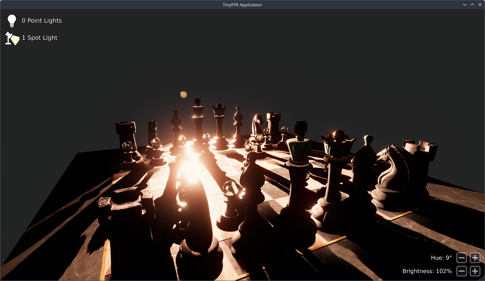

<div class="grid cards" markdown>

-   :octicons-beaker-16:{ : style="margin-right:0.3em" } __Overview__ [__View Code on Github &nbsp; :simple-github:__](https://github.com/Egodystonic/TinyFFR/tree/main/Examples/CanvasScenes){ : style="position: absolute; right: 1em;" }

    { align=right : style="max-width:50%; margin: 0em; margin-left: 1em;" }
    
    This tutorial builds on [Loading Assets](loading_assets.md). In this example, we will:

	* Add a 2D UI over the scene;
	* Make the most-recently added light editable using clickable buttons.
	
	__Unlike the previous example, you must hold the right mouse button to move the camera.__

	It's assumed that you've read the previous tutorials first, as things that were explained there won't be explained again in detail here.

</div>

## Project Setup

Like the previous tutorials, this example is set up as an ordinary .NET project. You can create one in an empty folder with the following two commands:

```
dotnet new console
dotnet add package Egodystonic.TinyFFR --prerelease
```

Alternatively, create a folder containing a `CanvasScenes.csproj` file with the following contents:

```xml
<Project Sdk="Microsoft.NET.Sdk">

	<PropertyGroup>
		<OutputType>Exe</OutputType>
		<TargetFramework>net10.0</TargetFramework>
		<ImplicitUsings>enable</ImplicitUsings>
		<Nullable>enable</Nullable>
	</PropertyGroup>

	<ItemGroup>
		<PackageReference Include="Egodystonic.TinyFFR" Version="*" />
	</ItemGroup>

	<ItemGroup>
		<None Update="ABeautifulGame.glb;metro_noord_4k.tffr;*.png" CopyToOutputDirectory="PreserveNewest" />
	</ItemGroup>

</Project>
```

### Asset Files

This example needs the following asset files, placed in your project folder (next to the `.csproj` file):

* [`ABeautifulGame.glb`](https://github.com/Egodystonic/TinyFFR/raw/main/Examples/CanvasScenes/ABeautifulGame.glb) and [`metro_noord_4k.tffr`](https://github.com/Egodystonic/TinyFFR/raw/main/Examples/CanvasScenes/metro_noord_4k.tffr): The chess set model and baked backdrop texture from [Loading Assets](loading_assets.md#asset-files).
* [`point_light_icon.png`](https://github.com/Egodystonic/TinyFFR/raw/main/Examples/CanvasScenes/point_light_icon.png) and [`spot_light_icon.png`](https://github.com/Egodystonic/TinyFFR/raw/main/Examples/CanvasScenes/spot_light_icon.png): Icons shown next to the light counts.
* [`button_minus.png`](https://github.com/Egodystonic/TinyFFR/raw/main/Examples/CanvasScenes/button_minus.png) and [`button_plus.png`](https://github.com/Egodystonic/TinyFFR/raw/main/Examples/CanvasScenes/button_plus.png): Images for the hue and brightness buttons.

If you created a project with `dotnet new console`, also add the second `<ItemGroup>` shown above to your `.csproj` file, so that the asset files are copied next to your compiled application.

Then, replace the contents of `Program.cs` with the code shown below.

### Running the Application

Open a terminal or command prompt in your project folder and run: `dotnet run -c Release`.

Loading the chess set model takes a few seconds, after which a window will appear showing the chess set with the overlay drawn on top. The controls are:

| Input | Action |
| :-- | :-- |
| Right mouse button (hold) + mouse | Orbit around the chess set |
| Mouse wheel | Zoom in / out |
| B | Toggle the backdrop on / off (off by default) |
| P | Add a point light at the camera's position |
| S | Add a spot light at the camera's position, pointing where the camera is looking |
| D | Remove all lights |
| Left-click on − / + | Decrease / increase the hue or brightness of the most recently placed light |
| Escape | Exit |

??? bug "TypeLoadWorkaround.cs (Crash with Exit Code 139)"
	On Linux, a bug in the .NET 9 and .NET 10 runtimes can make this example crash immediately on startup, before any of its code runs. There's no exception or error message; the process simply exits with a "Segmentation fault" (exit code `139`).

	The bug ([dotnet/runtime#130661](https://github.com/dotnet/runtime/issues/130661)) is in how the runtime loads certain struct types, and it's triggered when a program's `Main` method (including top-level statements like this example's `Program.cs`) uses some of TinyFFR's types before the types they contain have been loaded; such as canvas scenes, canvas images and text, and model bundles. It has been fixed in .NET 11.

	Until then, you can work around it by adding a file to your project that makes the runtime load TinyFFR's types in a safe order before your program starts. Download [`TypeLoadWorkaround.cs`](https://github.com/Egodystonic/TinyFFR/raw/main/Examples/CanvasScenes/TypeLoadWorkaround.cs) in to your project folder (no other changes are needed; it runs automatically via a [module initializer](https://learn.microsoft.com/en-us/dotnet/csharp/language-reference/attributes/general#moduleinitializer-attribute)).

	Windows and MacOS are not affected.

## Annotated Code

### Program.cs

The `Program.cs` file is mostly the same as shown in the previous example. The only changes are mostly invoking the `OverlayManager` which is explained below; but also we now use a `RendererCompositor` as well as a `Renderer`:

```csharp
using var scene = factory.SceneBuilder.CreateScene(); // (1)!
using var canvas = factory.SceneBuilder.CreateCanvasScene(); // (2)!
using var sceneRenderer = factory.RendererBuilder.CreateRenderer(scene, camera, window); // (3)!
using var canvasRenderer = factory.RendererBuilder.CreateRenderer(canvas, window); // (4)!
using var compositor = factory.RendererBuilder.CreateCompositor(window); // (5)!
compositor.Add(sceneRenderer, RenderCompositionType.Standard); // (6)!
compositor.Add(canvasRenderer, RenderCompositionType.RetainPreviousScenes); // (7)!
```

1.	This creates a standard scene, as we've done in every tutorial so far.

	We will add all 3D content (the chess set, the backdrop, the lights) to this scene as usual.
	
2.	This creates a `CanvasScene`; which is a 2D-only scene we can add images and text to.

3.	This creates a standard `Renderer`; also the same as we've done in every tutorial so far.

	This renderer will be used to render the 3D `scene`.
	
4.	This creates a second renderer specifically for rendering the 2D `canvas` scene.

	Note that a `CanvasScene` does not require a `Camera` to be rendered.
	
5.	This creates a `RendererCompositor`; renderer compositors can *composite* (i.e. combine) the output of multiple `Renderer`s together. In this case we've created a `compositor` targeting our `window`.

	In the following lines we'll add the `sceneRenderer` and `canvasRenderer` so we can render their combined output. 
	
	Inside the frame loop then all we need to do is invoke `compositor.RenderAll()` instead of `renderer.Render()`.
	
6.	This adds the 3D scene renderer to the composited output.

	The order that you add renderers to a compositor matters: The resultant output is drawn back-to-front (i.e. the first renderer you add is drawn first, and each subsequent renderer is drawn on top of the previous renderers' output).
	
	Therefore, to make our 2D overlay draw on top of the 3D scene, we must add the 3D renderer first, then the canvas renderer second.
	
	The `RenderCompositionType.Standard` means the 3D scene will be rendered in the standard fashion; drawing over the top of the previous data.
	
7.	This adds the canvas renderer to the compositor, to be drawn over the top of the 3D scene.

	The `RenderCompositionType.RetainPreviousScenes` argument means that the canvas scene will not erase the previously rendered pixels but instead draw over the top of it.

### OverlayManager.cs

This file is repsonsible for creating and updating the 2D overlay; the full annotated source is below:

```csharp
static class OverlayManager {
	// (1)!
	const float HueAdjustmentDegrees = 15f;
	const float BrightnessAdjustment = 0.1f;

	// (2)!
	static CanvasScene _canvas;
	static Texture _pointLightIconTexture;
	static Texture _spotLightIconTexture;
	static Texture _minusButtonTexture;
	static Texture _plusButtonTexture;
	static Font _font;
	static FontPen _pen;

	static CanvasImage _pointLightIcon;
	static CanvasText _pointLightCountText;
	static CanvasImage _spotLightIcon;
	static CanvasText _spotLightCountText;
	static CanvasText _hueText;
	static CanvasImage _hueMinusButton;
	static CanvasImage _huePlusButton;
	static CanvasText _brightnessText;
	static CanvasImage _brightnessMinusButton;
	static CanvasImage _brightnessPlusButton;

	public static void CreateOverlay(ILocalTinyFfrFactory factory, CanvasScene canvas) { // (3)!
		_canvas = canvas;
		// (4)!
		_pointLightIconTexture = factory.AssetLoader.LoadCanvasTexture("point_light_icon.png");
		_spotLightIconTexture = factory.AssetLoader.LoadCanvasTexture("spot_light_icon.png");
		_minusButtonTexture = factory.AssetLoader.LoadCanvasTexture("button_minus.png");
		_plusButtonTexture = factory.AssetLoader.LoadCanvasTexture("button_plus.png");
		_font = factory.AssetLoader.LoadFont(); // (5)!
		_pen = _font.CreatePen(BuiltInFontPenStyle.WhiteWithOutline); // (6)!

		_pointLightIcon = canvas.Add(_pointLightIconTexture); // (7)!
		_pointLightIcon.SetPlacementPixels(Orientation2D.UpLeft, (20, 20), (80, 80)); // (8)!
		_pointLightCountText = canvas.Add("", _pen); // (9)!
		_pointLightCountText.SetDockParent<CanvasImage>(_pointLightIcon); // (10)!
		_pointLightCountText.SetPlacementFraction(Orientation2D.Right, (-0.15f, 0f), 0.45f); // (11)!
		_pointLightCountText.ObjectAnchor = Orientation2D.Left; // (12)!

		// (13)!
		_spotLightIcon = canvas.Add(_spotLightIconTexture);
		_spotLightIcon.SetPlacementPixels(Orientation2D.UpLeft, (20, 110), (80, 80));
		_spotLightCountText = canvas.Add("", _pen);
		_spotLightCountText.SetDockParent<CanvasImage>(_spotLightIcon);
		_spotLightCountText.SetPlacementFraction(Orientation2D.Right, (-0.15f, 0f), 0.45f);
		_spotLightCountText.ObjectAnchor = Orientation2D.Left;

		// (14)!
		_brightnessPlusButton = canvas.Add(_plusButtonTexture);
		_brightnessPlusButton.SetPlacementPixels(Orientation2D.DownRight, (20, 20), (60, 60));
		_brightnessMinusButton = canvas.Add(_minusButtonTexture);
		_brightnessMinusButton.SetPlacementPixels(Orientation2D.DownRight, (90, 20), (60, 60));
		_brightnessText = canvas.Add("", _pen);
		_brightnessText.SetPlacementPixels(Orientation2D.DownRight, (170, 33), 34);

		_huePlusButton = canvas.Add(_plusButtonTexture);
		_huePlusButton.SetPlacementPixels(Orientation2D.DownRight, (20, 90), (60, 60));
		_hueMinusButton = canvas.Add(_minusButtonTexture);
		_hueMinusButton.SetPlacementPixels(Orientation2D.DownRight, (90, 90), (60, 60));
		_hueText = canvas.Add("", _pen);
		_hueText.SetPlacementPixels(Orientation2D.DownRight, (170, 103), 34);
	}

	public static void UpdateOverlay(ResourceGroup lights, Light? mostRecentLight) { // (15)!
		static void UpdateLightCountText(CanvasText text, int count, string lightTypeName) { // (16)!
			Span<char> textBuffer = stackalloc char[32];
			textBuffer.TryWrite($"{count} {lightTypeName}{(count == 1 ? "" : "s")}", out var charsWritten);
			text.SetText(textBuffer[..charsWritten]);
		}

		// (17)!
		UpdateLightCountText(_pointLightCountText, lights.PointLights.Count, "Point Light");
		UpdateLightCountText(_spotLightCountText, lights.SpotLights.Count, "Spot Light");

		// (18)!
		var panelIsVisible = mostRecentLight.HasValue;
		_hueText.IsVisible = panelIsVisible;
		_hueMinusButton.IsVisible = panelIsVisible;
		_huePlusButton.IsVisible = panelIsVisible;
		_brightnessText.IsVisible = panelIsVisible;
		_brightnessMinusButton.IsVisible = panelIsVisible;
		_brightnessPlusButton.IsVisible = panelIsVisible;
		if (mostRecentLight is not { } light) return;

		// (19)!
		Span<char> textBuffer = stackalloc char[32];
		textBuffer.TryWrite($"Hue: {light.ColorHue.Degrees:N0}°", out var charsWritten);
		_hueText.SetText(textBuffer[..charsWritten]);
		textBuffer.TryWrite($"Brightness: {PercentageUtils.ConvertFractionToPercentageString(light.Brightness, "N0")}", out charsWritten);
		_brightnessText.SetText(textBuffer[..charsWritten]);
	}

	public static void HandleInput(ILatestKeyboardAndMouseInputRetriever kbm, ResourceGroup lights, Light? mostRecentLight) { // (20)!
		var cursorPosition = _canvas.ConvertRenderTargetCoordToLocal(kbm.MouseCursorPosition); // (21)!
		foreach (var button in (ReadOnlySpan<CanvasImage>) [_hueMinusButton, _huePlusButton, _brightnessMinusButton, _brightnessPlusButton]) {
			button.Opacity = button.Contains(cursorPosition) ? 1f : 0.7f; // (22)!
		}

		if (kbm.KeyWasPressedThisIteration(KeyboardOrMouseKey.MouseLeft) && mostRecentLight is { } light) {
			var clickedImage = _canvas.QueryProvider.GetTopmostObjectUnderLocalCoord<CanvasImage>(cursorPosition); // (23)!
			if (clickedImage == _hueMinusButton) light.ColorHue -= HueAdjustmentDegrees;
			else if (clickedImage == _huePlusButton) light.ColorHue += HueAdjustmentDegrees;
			else if (clickedImage == _brightnessMinusButton) light.Brightness = MathF.Max(0f, light.Brightness - BrightnessAdjustment);
			else if (clickedImage == _brightnessPlusButton) light.Brightness += BrightnessAdjustment;
			UpdateOverlay(lights, mostRecentLight);
		}
	}

	public static void DisposeOverlay() { // (24)!
		_pointLightCountText.Dispose();
		_pointLightIcon.Dispose();
		_spotLightCountText.Dispose();
		_spotLightIcon.Dispose();
		_hueText.Dispose();
		_hueMinusButton.Dispose();
		_huePlusButton.Dispose();
		_brightnessText.Dispose();
		_brightnessMinusButton.Dispose();
		_brightnessPlusButton.Dispose();
		_pen.Dispose();
		_font.Dispose();
		_pointLightIconTexture.Dispose();
		_spotLightIconTexture.Dispose();
		_minusButtonTexture.Dispose();
		_plusButtonTexture.Dispose();
	}
}
```

1.	These two lines set how much the lights' hue + brightness will be adjusted when clicking the adjustment buttons; adjust to taste.

2.	All of these fields hold created canvas data- each is explained in the annotations below.

3.	This function is invoked once at initialization time and is responsible for creating the canvas objects.

4.	The following four lines load the four texture files to be used as canvas icons.

	`LoadCanvasTexture()` loads the requested texture file on to the GPU in a format best suited for canvas display. It returns a `Texture` resource that can be disposed when no longer needed to free the GPU's VRAM.
	
5.	This loads TinyFFR's default built-in font, loads all necessary data on to the GPU, and returns a `Font` resource.

	You can specify an argument to `LoadFont()` to load a different built-in font or a custom font file.
	
6.	Before you can draw text in TinyFFR, you need both a `Font` *and* at least one `FontPen` that defines *how* the text should be drawn.

	In this case we use a built-in style "White With Outline".
	
7.	`canvas.Add()` adds a previously-loaded texture to the canvas scene; returning a `CanvasImage` instance you can use to modify the added texture instance.

8.	`SetPlacementPixels()` sets the placement of a `CanvasImage` (or `CanvasText`) on a canvas scene; specified in pixels.

	In this case we're setting our `_pointLightIcon` to be in the top-left corner of the canvas (`Orientation2D.UpLeft`). It's offset from that anchor by 20 pixels in both the X and Y direction (`(20, 20)`); and will be drawn at a size of 80 x 80 pixels (`(80, 80)`).
	
9.	This creates a point-light count text `CanvasText` instance, using the `_pen` created earlier. In the following lines we'll set the text's positioning.

10.	This sets the `_pointLightCountText` instance's *dock parent* to the `_pointLightIcon`.

	A dock parent specifies what the object is placed and sized *relative* to; meaning the subsequent `SetPlacementFraction(...)` call will place/scale our text instance relative to the point-light icon.
	
	By default, all canvas objects' dock parent is `null`, meaning their placement is always relative to the entire canvas.
	
11.	`SetPlacementFraction()` sets the placement of our `_pointLightCountText` on the canvas as relative fractions of its dock parent's position/size (rather than as a specific pixel value, i.e. `SetPlacementPixels()`).

	The first argument (`Orientation2D.Right`) means that we're placing the text relative to the right-edge of the point-light icon.
	
	The second argument (`(-0.15f, 0f)`) means that we're offsetting the relative position by 15% of the icon's width and 0% of its height. A negative X-value means the text moves *left* rather than right (i.e. away from the icon).
	
	The third argument (`0.45f`) means the text's height is 45% of the label's height.
	
12.	The point-light text instance's placement has so far been specified by its dock parent (`_pointLightIcon`) and placement anchor (`Orientation2D.Right`); meaning its position will be set relative to the right-hand edge of the point-light icon.

	However, we still have one free variable that defines where exactly the `TextInstance` will be placed: Which edge/corner of the text should be placed at the dock parent anchor offset?
	
	Setting the `ObjectAnchor` defines this. By setting `_pointLightCountText.ObjectAnchor` we're telling TinyFFR that we want the text's left-edge to be that edge.
	
13.	These lines follow the same logic as the point-light text + image setup above; just repeated for the spotlight count.

14.	The following two groups of code set up the brightness + hue controls, using the same techniques explained above.

15.	This method is invoked when the canvas UI should be updated (i.e. we've added a light, changed a light's colour/brightness, etc).

16.	A local helper method that updates a `CanvasText` according to the number of lights registered for its light type.

	`text.SetText()` is the `CanvasText` method used to update a text instance's text.
	
17.	These two lines update the point light and spot light count texts according to the number of each light type currently active in the scene.

18.	These lines set whether the hue + brightness controls are visible, according to whether or not the scene contains at least one light.

	Setting `IsVisible` on a scene object lets you hide or unhide them, and is better for performance than disposing + recreating the resources repeatedly.
	
19.	These lines set the hue + brightness text according to the values on the `mostRecentLight`.

20.	This method is invoked once per frame when we want the overlay manager to handle user input for our canvas scene.

21.	This gets the current mouse cursor position relative to our `window` via `kbm.MouseCursorPosition`.

	We then convert that position to a canvas-local position via `_canvas.ConvertRenderTargetCoordToLocal()`. This conversion is necessary for a few reasons including desktop DPI scaling, PiP/splitscreen rendering, etc. 
	
	Once we've converted the co-ordinate, `cursorPosition` can be used for testing the mouse cursor against canvas objects in the subsequent lines.
	
22.	This foreach loop iterates over each +/- button for the hue and brightness and determines whether the mouse cursor is currently hovering over them.

	`button.Contains()` checks whether the button contains the cursor position. If it does, we set the button's `Opacity` to 100%, otherwise it's set to 70%.
	
23.	This returns the first `CanvasImage` underneath the cursor (or `null` if there is none); using the canvas scene's `QueryProvider`. 

	Depending on which image we clicked on, in the subsequent lines we adjust the light's colour or brightness accordingly; and then re-update our overlay.
	
24.	Everything we allocated above at initialization-time must be disposed when we're done with them. `DisposeOverlay()` is invoked when the application is closing.

	Note also that the disposal order is important: We can't dispose the `_pen` before disposing any `CanvasText` items that rely on it; and similarly we must dispose any `CanvasImage`s before disposing their parent `Texture` resources.

## Additional Notes

### Canvas Scenes vs Full UI Integrations

`CanvasScene`s are provided as a quick, fast, and easy way to add 2D overlays or HUDs to your application. However, they're not really meant to replace a full UI framework; for that we recommend using [ImGui](../reference/imgui_integration.md); or adding TinyFFR to a full UI framework such as [Avalonia](../reference/avalonia_integration.md), [WPF](../reference/wpf_integration.md), or [Windows Forms](../reference/winforms_integration.md).

Some of the showcase example applications provided in the following pages demonstrate these full UI integrations.

## Stuff to Tinker With

Here are some things you can experiment with (with links to relevant documentation pages).

* [:material-book-open-page-variant: Colour](../reference/colour.md): You could try adding buttons for the light colour's saturation and lightness.
* [:material-book-open-page-variant: Canvas Scenes](../reference/canvas_scenes.md): You could try showing the most recent light's brightness as a bar, or adding a panel background behind the buttons.
* [:material-book-open-page-variant: Compositing](../reference/compositing.md): You could try rendering the canvas in to only part of the window, or adding a second 3D scene as a picture-in-picture view.
* [:material-book-open-page-variant: Text Instances](../reference/text_instances.md#pens): You could try editing the pens used to render text.
* [:material-book-open-page-variant: Loading Fonts](../reference/loading_fonts.md): You could try loading your own font.
* [:material-book-open-page-variant: Point Lights](../reference/point_lights.md) / [Spot Lights](../reference/spot_lights.md): You could try adding buttons for other light properties, such as a spot light's cone angle or a point light's range.
