The previous program examples each fit in to one or two short files; real applications are typically bigger. Unlike the previous pages, this tutorial is not about example code; instead it uses flowcharts to help guide you in creating real TinyFFR programs. 

The diagrams here show you what gets created when your application starts, how resources come and go while it runs, and how everything is cleaned up at the end. Once you're familiar with this overall flow, you can use it as a map for structuring larger applications. The [example application flows](#example-application-flows) at the end of the page show how it stretches to fit a few common kinds of application.

## Overview

Every TinyFFR application has three phases:

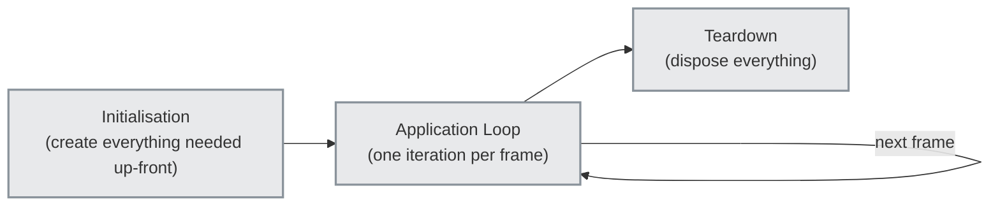

### 1. Initialisation

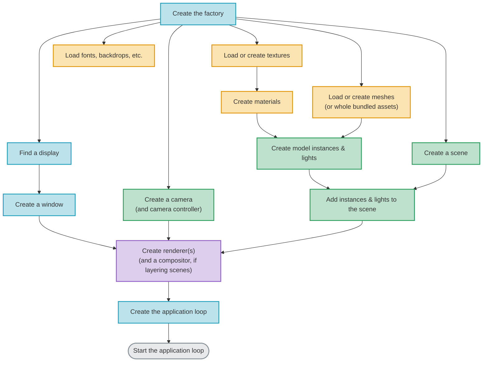

The factory always comes first: Every other resource is created through one of its builders, and only one factory can exist at a time. After that, the order of initialisation is mostly dictated by which resources *use* which other resources. For example, a material needs its textures to exist before it can be created; a model instance needs a mesh and a material; and a renderer needs a scene, a camera, and a window (or other render target) to render with.

Initialisation is also the natural place for slow work. Loading and processing asset files can take a noticeable amount of time (see [:material-book-open-page-variant: Pre-Baking Assets](../reference/pre-baking_assets.md)), so most applications load whatever they'll definitely need before their application loop starts, rather than in the middle of it. Of course, there will often be some assets that must be loaded on demand during runtime; but loading as much as possible on startup is advisable.

### 2. The Application Loop

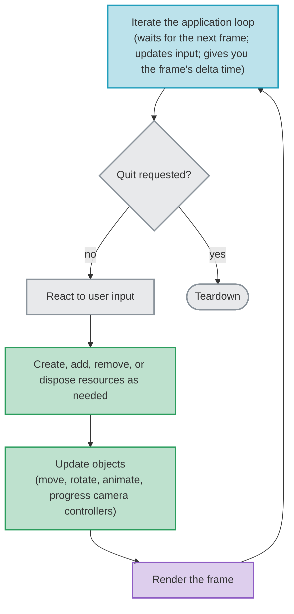

Each iteration of the loop produces one frame. Iterating the [application loop](../reference/application_loops.md) waits until it's time for the next frame, updates the state of every input device, and tells you how much time has passed since the previous frame (the *delta time*, used to keep movement and animation independent of the framerate). Your application then reacts to the user's input, makes whatever changes it needs to the world, and finally renders the frame.

The loop ends when the user asks to quit (e.g. by closing the window), or whenever your application decides to stop.

??? info "Asynchronous Loads Finish During Iteration"
	[:material-book-open-page-variant: Asynchronous Loading](../reference/asynchronous_loading.md) moves a lot of the work of asset loading on to background threads, but each load's final steps (such as creating the asset's GPU resources) must be performed on your application's main thread. TinyFFR performs these steps each time the application loop is iterated, for up to a limited amount of time per frame:

	```mermaid
	flowchart TD
		start["Start an asynchronous load"]:::asset
		background["Background threads:<br/>read & process the file"]:::asset
		queue["Final steps queued for the main thread"]:::asset
		iterate["Next application loop iteration:<br/>queued steps performed, up to a per-frame time budget"]:::env
		more{"All steps done?"}:::step
		ready["Load result available<br/>(fetch it and use the asset)"]:::asset

		start --> background --> queue --> iterate --> more
		more -- "no; continue next frame" --> iterate
		more -- "yes" --> ready

		classDef env fill:#219ebc,fill-opacity:0.3,stroke:#219ebc,stroke-width:2px
		classDef asset fill:#f4a300,fill-opacity:0.3,stroke:#e09400,stroke-width:2px
		classDef step fill:#8a939b,fill-opacity:0.2,stroke:#8a939b,stroke-width:2px
	```

	Meanwhile your application keeps running and rendering frames as normal; e.g. to animate a loading screen or keep the game playable. The size of the per-frame time budget trades loading speed against framerate; see [:material-book-open-page-variant: Async Loading Time-Sharing](../reference/async_loading_time_sharing.md).

??? info "GPU Memory Is Freed a Few Frames After Disposal"
	Disposing a resource immediately removes it from your application (it can no longer be used). However, the GPU may still be drawing frames that were submitted before the resource was disposed, so the GPU memory it used is only freed once those frames have finished:

	```mermaid
	flowchart TD
		dispose["Dispose a resource"]:::asset
		gone["The resource can no longer be used"]:::asset
		inflight["Frames already submitted to the GPU<br/>finish drawing"]:::render
		freed["GPU memory freed<br/>(typically a few frames later)"]:::render

		dispose --> gone --> inflight --> freed

		classDef asset fill:#f4a300,fill-opacity:0.3,stroke:#e09400,stroke-width:2px
		classDef render fill:#8e5cc4,fill-opacity:0.3,stroke:#8e5cc4,stroke-width:2px
	```

	This rarely matters, but it does mean that GPU memory usage doesn't drop the instant you dispose something. Waiting for the GPU (via the renderer or compositor) lets the memory be freed straight away, which can be worthwhile after disposing a large batch of resources. See [:material-book-open-page-variant: Controlling RAM & VRAM Usage](../reference/controlling_ram_and_vram_usage.md#when-vram-is-used-freed).

#### Runtime Churn

Most applications can't create *everything* up-front. Objects appear and disappear while the application runs (e.g. a bullet being fired, an enemy being defeated, or a user opening a new file). The following flowchart shows the usual way to handle adding a new object:

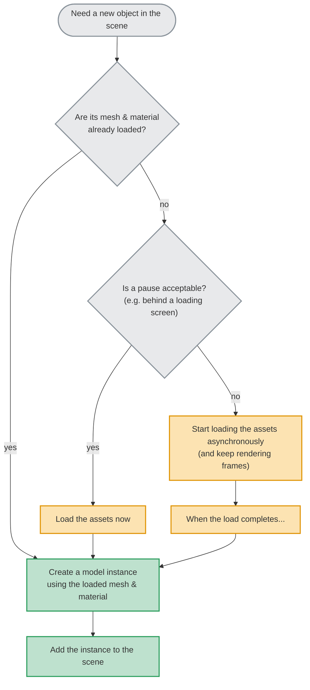

And for removing an object:

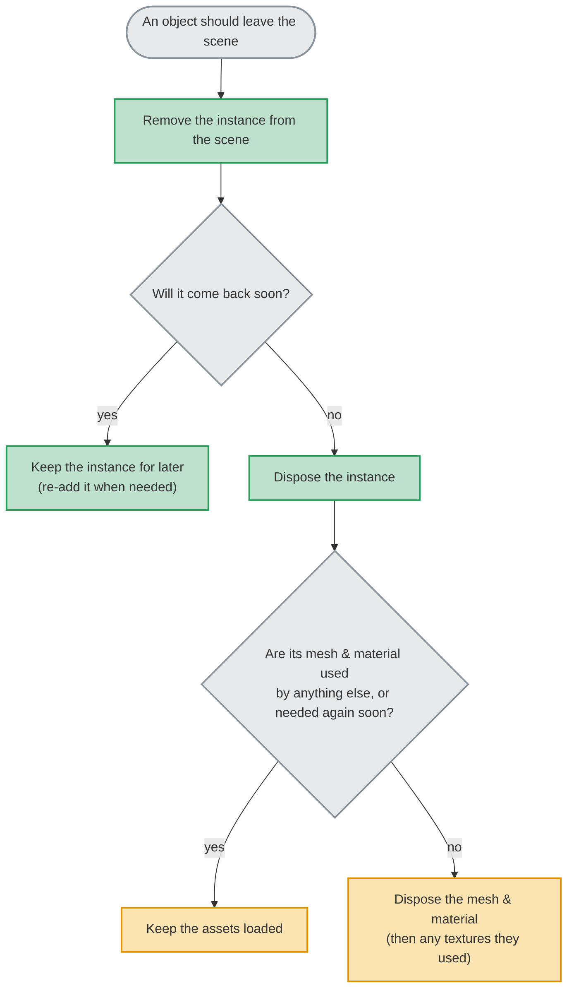

A few general principles apply:

* **Create assets once, use them many times.** Meshes, materials, and textures are the expensive part of an object (to load, and in memory). Model instances are cheap: A thousand instances of the same mesh and material cost barely more than one. Load each asset once and share it between every instance that uses it.
* **Removing is not disposing.** Removing an object from a scene just stops it being drawn; the object still exists and can be added back (or added to a different scene) later. Disposing it destroys it permanently. Something that's only hidden temporarily can simply be removed and re-added. Pooling objects and adding/removing them to a scene as desired is a valid strategy.
* **Swap rather than recreate.** Many things can be changed in-place rather than destroyed and rebuilt. An instance's material can be changed, a scene's backdrop can be replaced, lights can be moved and recoloured, and so on.
* **Group resources that live and die together.** When a set of resources is always disposed at the same time (e.g. everything belonging to one level), adding them to a [resource group](../reference/resource_groups.md) as they're created lets you dispose them all at once, in the right order.

### 3. Teardown

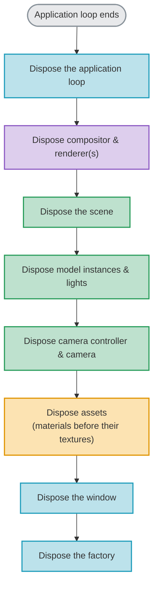

Teardown is initialisation in reverse; each resource is disposed before the resources it uses. The factory is always disposed last.

If you create your resources with C#'s `using` declarations (as the previous tutorials did), this happens automatically (`using` declarations are disposed in the reverse order they were declared, at the end of their scope). Note however that as applications grow in size and complexity, relying on `using` statements tends to become less feasible. 

Resources that you create and keep elsewhere (e.g. in fields, collections, or resource groups) need disposing yourself, before the resources they use are disposed.

## Dependencies & Disposal Order

TinyFFR keeps track of which resources use which other resources. A resource that's still in use by another (its *dependent*) can't be disposed; attempting to do so throws a `ResourceDependencyException`, and the resource is left as it was. The main dependencies look like this (an arrow points from a resource to the resources it depends on):

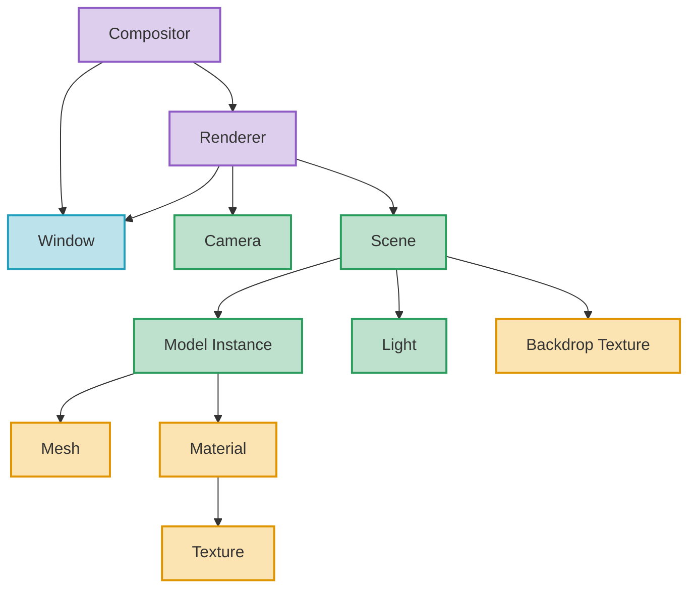

The rule is simple: **Dispose a resource only once nothing above it in this graph still uses it.** Disposing everything in the reverse order it was created always satisfies this rule, as a resource can only ever depend on resources that existed before it.

During the application loop, dependencies are released when the dependent stops using a resource, not only when it's disposed. For example, removing a model instance from a scene releases the scene's dependency on it (so the instance can then be disposed), and changing an instance's material releases its dependency on the old material. The full list of tracked dependencies is on [:material-book-open-page-variant: Resource Dependencies](../reference/resource_dependencies.md).

## Example Application Flows

The following flowcharts show how the same three phases stretch to fit a few common kinds of application.

### Game With Levels

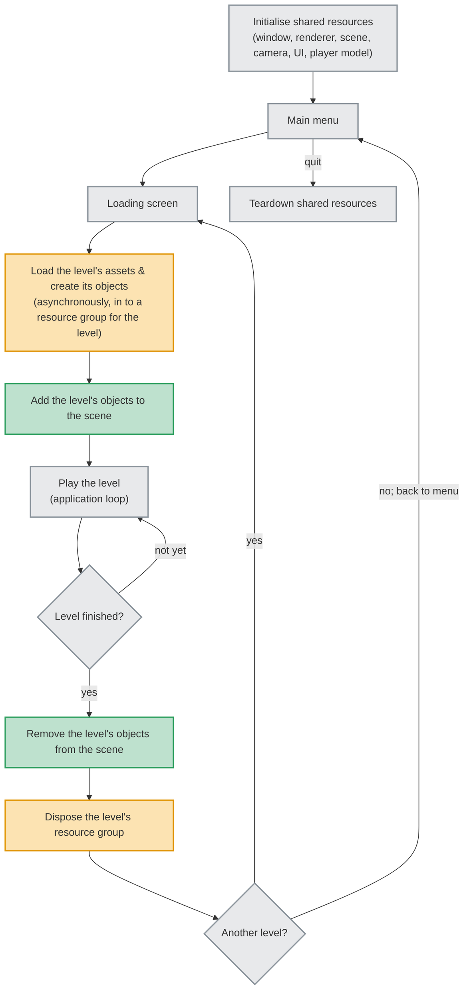

Resources that are needed throughout the game (the window, renderer, scene, UI, the player's model, etc.) are created once and live for the whole application. Everything specific to a level is created when the level loads and disposed when it ends. The loading screen is itself just the application loop running as normal while the level loads [asynchronously](../reference/asynchronous_loading.md) in the background. [:material-book-open-page-variant: Pre-Baking Assets](../reference/pre-baking_assets.md) can make that loading screen *much* shorter.

### Model Viewer / Editor

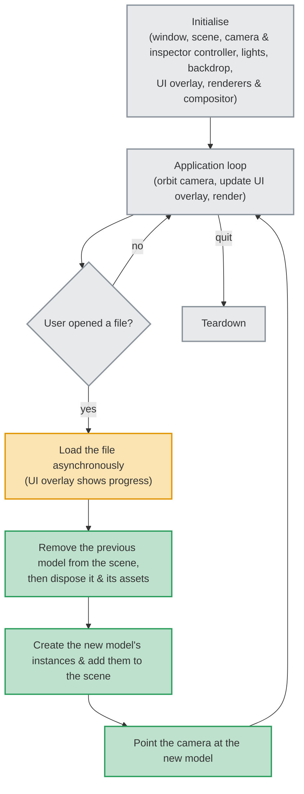

A tool like a model viewer runs for a long time, and most of its resources (the window, scene, camera, lighting, and [2D overlay](adding_a_2d_overlay.md)) live for the whole session. Only the model being viewed changes. Loading the new model asynchronously keeps the interface responsive while a large file loads, and the previous model is only replaced once the new one is ready.

### Streaming Open World

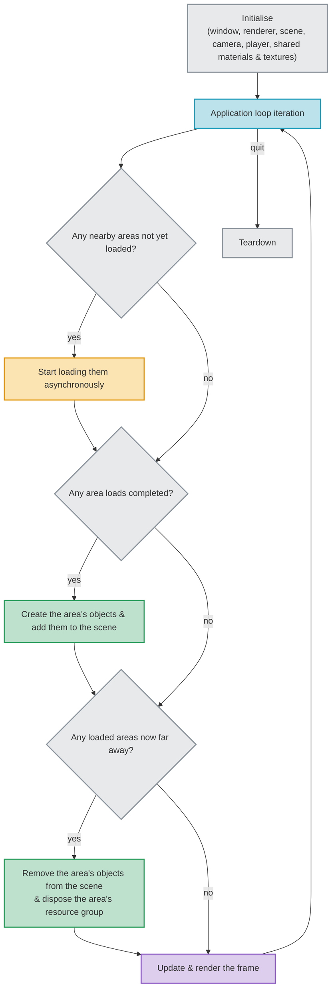

Here there's no loading screen at all. Instead, areas of the world are loaded in the background as the player approaches them, and disposed once they're far enough away to no longer be needed. Each area's resources are kept in their own [resource group](../reference/resource_groups.md) so that an area can be unloaded in one step. Because asynchronous loads share each frame's time with rendering, the per-frame budget (see [:material-book-open-page-variant: Async Loading Time-Sharing](../reference/async_loading_time_sharing.md)) controls the balance between how quickly areas appear and how smooth the framerate stays. Resources shared by every area (such as common materials and textures) are loaded once at start-up and kept for the whole application.

### UI-Framework Hosted Application

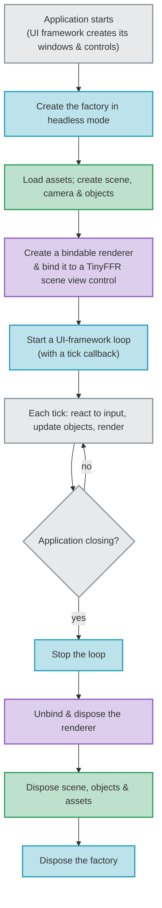

When TinyFFR is embedded in a UI framework (such as [Avalonia](../reference/avalonia_integration.md), [WPF](../reference/wpf_integration.md), or [Windows Forms](../reference/winforms_integration.md)), the framework owns the application's windows and its main loop. Rather than creating a window and iterating an application loop yourself, you place a TinyFFR scene view control in your interface, bind a renderer to it, and start a UI-framework loop that calls your *tick* callback once per frame. Inside the callback, the flow is the same as any other application loop iteration. The three phases are otherwise unchanged: resources are still created at start-up and disposed (in reverse order) when the application closes.

## Where Next

The following pages show some real-world showcase applications that demonstrate the principles explained above.

Additionally, each part of this flow is covered in more detail in the reference documentation:

* [:material-book-open-page-variant: Application Loops](../reference/application_loops.md): Iterating the loop, controlling framerate, and reading time and input.
* [:material-book-open-page-variant: Asynchronous Loading](../reference/asynchronous_loading.md) and [:material-book-open-page-variant: Async Loading Time-Sharing](../reference/async_loading_time_sharing.md): Loading assets without pausing your application.
* [:material-book-open-page-variant: Resource Dependencies](../reference/resource_dependencies.md) and [:material-book-open-page-variant: Resource Groups](../reference/resource_groups.md): Disposal order, and managing many resources at once.
* [:material-book-open-page-variant: Pre-Baking Assets](../reference/pre-baking_assets.md): Making loading (and loading screens) much faster.
* [:material-book-open-page-variant: Controlling RAM & VRAM Usage](../reference/controlling_ram_and_vram_usage.md): What uses memory, and when it's freed.
