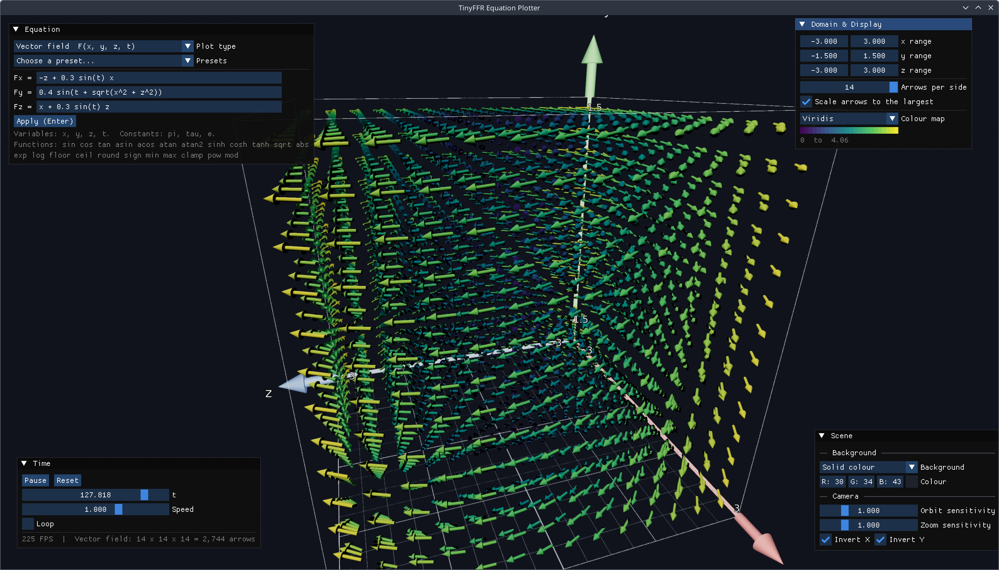
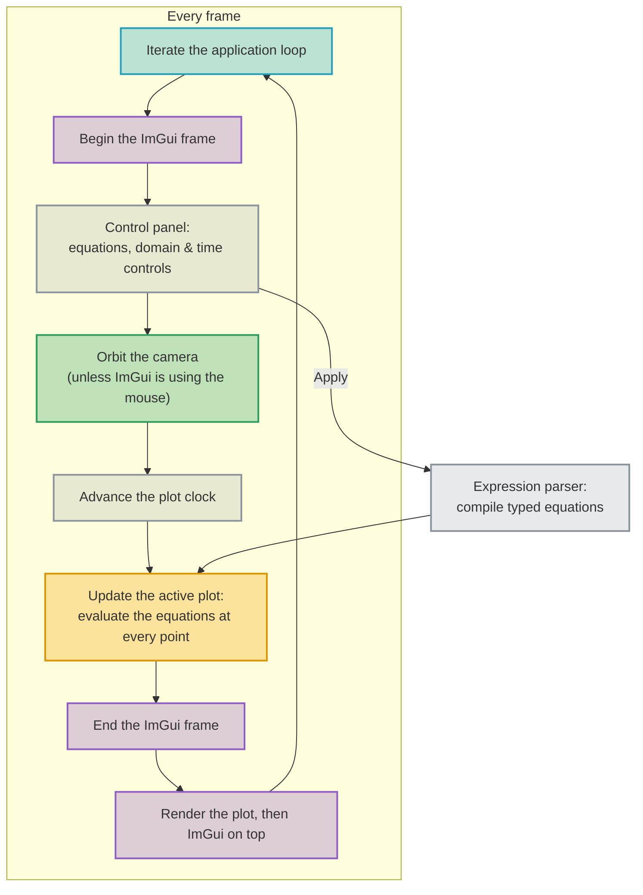

<div class="grid cards" markdown>

-   :octicons-beaker-16:{ : style="margin-right:0.3em" } __Overview__ [__View Code on Github &nbsp; :simple-github:__](https://github.com/Egodystonic/TinyFFR/tree/main/Examples/EquationPlotter){ : style="position: absolute; right: 1em;" }

	{ align=right : style="max-width:80%; margin: 0em; margin-left: 1em;" }
    
    This uses TinyFFR to plot graphs and vector fields in 3D in realtime.

</div>

## :material-flask-outline: Demonstrated Features

* [:material-book-open-page-variant: Dynamic Meshes & Mutable Grids](../reference/dynamic_meshes_and_mutable_grids.md#mutable-grids) | [:material-book-open-page-variant: Writable Textures](../reference/writable_textures.md): Animating a surface on a mutable grid, coloured via a writable texture;
* [:material-book-open-page-variant: Creating Meshes](../reference/creating_meshes.md#arrow) | [:material-book-open-page-variant: Scene Objects](../reference/scene_objects.md): Drawing a vector field with thousands of arrow model instances;
* [:material-book-open-page-variant: Dynamic Meshes & Mutable Grids](../reference/dynamic_meshes_and_mutable_grids.md#dynamic-vertex-buffers): Generating a parametric surface in a dynamic vertex buffer;
* [:material-book-open-page-variant: Dear ImGui Integration](../reference/imgui_integration.md): Drawing the application's controls with Dear ImGui, on top of a 3D scene;
* [:material-book-open-page-variant: Orbital Camera Controller](../reference/camera_controller_orbital.md): Orbiting the camera around the plot.

## Running It

Download (or clone) the whole [`Examples/EquationPlotter`](https://github.com/Egodystonic/TinyFFR/tree/main/Examples/EquationPlotter) folder, then open a terminal in that folder and run `dotnet run -c Release`.

Choose a plot type and a preset from the __Equation__ window to get started, then try editing the equations.

| Action | Control |
| :-- | :-- |
| Orbit the camera | Hold left or right mouse button + move mouse |
| Zoom | Mouse wheel |
| Apply an edited equation | Enter (or the Apply button) |
| Exit | Escape |

??? bug "TypeLoadWorkaround.cs (Crash with Exit Code 139)"
	On Linux, a bug in the .NET 9 and .NET 10 runtimes can make this example crash immediately on startup, before any of its code runs. There's no exception or error message; the process simply exits with a "Segmentation fault" (exit code `139`).

	The bug ([dotnet/runtime#130661](https://github.com/dotnet/runtime/issues/130661)) is in how the runtime loads certain struct types, and it's triggered when some of TinyFFR's types are used before the types they contain have been loaded. It has been fixed in .NET 11.

	Until then, the example works around it with [`TypeLoadWorkaround.cs`](https://github.com/Egodystonic/TinyFFR/raw/main/Examples/EquationPlotter/TypeLoadWorkaround.cs), which makes the runtime load TinyFFR's types in a safe order before the program starts (it runs automatically via a [module initializer](https://learn.microsoft.com/en-us/dotnet/csharp/language-reference/attributes/general#moduleinitializer-attribute)).

	Windows and MacOS are not affected.

## Plot Types

| Plot type | Equations | Drawn as |
| :-- | :-- | :-- |
| Surface | `y = f(x, z, t)` | A [mutable grid](../reference/dynamic_meshes_and_mutable_grids.md#mutable-grids) whose heights are rewritten every frame |
| Vector field | `F(x, y, z, t) = (Fx, Fy, Fz)` | A lattice of arrows (one model instance each), pointing along the field and coloured by its strength |
| Parametric surface | `(x, y, z) = f(u, v, t)` | A mesh generated in a [dynamic vertex buffer](../reference/dynamic_meshes_and_mutable_grids.md#dynamic-vertex-buffers) every frame |
| Scalar field slice | `w = f(x, y, z, t)` | A flat grid that slices through the field, coloured by its value |

In every case, `t` is time: the plot is re-evaluated every frame as `t` advances, so equations that use `t` animate.

## Architecture



| File | What it does |
| :-- | :-- |
| `Program.cs` | Creates the window, scene, camera, renderers and compositor, and runs the application loop. |
| `ExpressionTokenizer.cs` / `ExpressionParser.cs` / `CompiledExpression.cs` | Turn a typed equation in to a compact list of instructions, and evaluate it. |
| `PlotController.cs` | Owns the active plot and the compiled equations; switches between plot types. |
| `PlotDomain.cs` | The ranges being plotted, the resolution of each plot, and other display settings. |
| `SurfacePlot.cs` / `VectorFieldPlot.cs` / `ParametricSurfacePlot.cs` / `ScalarSlicePlot.cs` | One class per plot type. |
| `GridTexture.cs` | A writable texture used to colour a grid one texel per vertex. |
| `ColorMap.cs` | The colour maps that turn a value in to a colour. |
| `AxesGizmo.cs` | The box, axes, labels, and floor grid around the plot. |
| `PlotClock.cs` | The time `t`: playing, pausing, speed, and looping. |
| `SceneSettings.cs` | The background, the camera's sensitivity and inversion settings, the label settings, and which parts of the plot box (box, axes, and grids) are shown. |
| `ControlPanel.cs` | Every ImGui window. |
| `Presets.cs` | The built-in example equations. |

All four plot types draw in to the same 4 × 4 × 4 metre box around the origin; the ranges set in the __Domain & Display__ window decide which part of each equation that box shows (see `PlotDomain.cs`). Because the box never changes size, the camera never needs to be re-framed, whatever ranges are chosen.

Typed equations are turned in to something that can be evaluated quickly by the example's own small expression parser (`ExpressionParser.cs`). It isn't specific to TinyFFR, so it isn't covered on this page; but evaluating a parsed equation never allocates any memory, so the plots can re-evaluate their equations at tens of thousands of points every frame without generating garbage.

## Surfaces on a Mutable Grid

A surface is a [mutable grid](../reference/dynamic_meshes_and_mutable_grids.md#mutable-grids): a flat sheet of vertices whose heights can be changed at any time. Every frame, the surface plot evaluates its equation at every vertex, and writes the result as that vertex's height:

```csharp
public void Update(float time, CompiledExpression[] expressions) {
	var expression = expressions[0];
	Span<float> variables = stackalloc float[3];
	variables[2] = time;

	using (var lease = _grid.BorrowVerticesSpan(permitLateralDisplacement: false, recalculateNormals: true)) {
		var vertices = lease.Span;
		for (var i = 0; i < vertices.Length; ++i) {
			var normalized = _grid.GetVertexCoordinateNormalized(i);
			variables[0] = _domain.FromNormalizedX(normalized.X);
			variables[1] = _domain.FromNormalizedZ(normalized.Y);
			var value = expression.Evaluate(variables);
			var height = Single.IsFinite(value) ? Math.Clamp(_domain.ToWorldY(value), -PlotDomain.WorldHalfSize, PlotDomain.WorldHalfSize) : 0f;
			vertices[i] = new MutableGridVertex(height);
			_colors.Set(_grid.GetVertexCoordinate(i), ColorMap.SampleTexel(_domain.ColorMap, height / (PlotDomain.WorldHalfSize * 2f) + 0.5f));
		}
	}
	_colors.Upload();
}
```

* `GetVertexCoordinateNormalized()` gives each vertex's position on the grid (from -0.5 to 0.5 in each direction), which the domain turns in to the `x` and `z` values for the equation.
* `recalculateNormals: true` makes the grid recalculate which way each part of the surface faces, so that it's lit according to its shape.
* The grid's bounding box is set from `maxHeightDisplacement` when it's created, so heights are clamped to the plot box; anything outside it would otherwise be culled.

Mutable grid vertices don't have a colour of their own, so each surface is coloured by a [writable texture](../reference/writable_textures.md) with one texel for every vertex. The texture is stretched over the whole grid, so each texel lands on its vertex:

```csharp
public void Set(XYPair<int> gridCoordinate, TexelRgb24 texel) {
	_texels[(Dimensions.Y - 1 - gridCoordinate.Y) * Dimensions.X + gridCoordinate.X] = texel;
}
```

Texture data is written from the top row down, whereas the grid's coordinates count up from the bottom, so the row is flipped.

## Vector Fields with Arrow Instances

A vector field is drawn as a lattice of arrows: one [model instance](../reference/scene_objects.md) per lattice point, all sharing a single arrow mesh (created with `MeshBuilder.CreateArrow()`; see [Creating Meshes](../reference/creating_meshes.md#arrow)). Every frame, once the field has been evaluated at each arrow's position, each arrow is rotated to point along the field, and stretched according to the field's strength:

```csharp
if (lengthFraction <= 0.001f || vector.Direction == Direction.None) {
	arrow.SetScaling(Vect.Zero);
	continue;
}

var length = _cellSize * ArrowCellFraction * lengthFraction;
var thickness = _cellSize * ArrowCellFraction;
arrow.SetRotation(Rotation.FromStartAndEndDirection(Direction.Forward, vector.Direction));
arrow.SetScaling(new Vect(thickness, thickness, length));

var paletteIndex = largestMagnitude > 0f ? Math.Min((int) (magnitude / largestMagnitude * PaletteSize), PaletteSize - 1) : 0;
if (paletteIndex == _paletteIndices[i]) continue;
_paletteIndices[i] = paletteIndex;
arrow.SetMaterial(_paletteMaterials[paletteIndex]);
```

* The arrow mesh points along `Direction.Forward`, so `Rotation.FromStartAndEndDirection()` turns it to face along the field, and the scaling stretches it along its length (the Z axis) only, so that thin arrows stay thin.
* An arrow with nothing to show (where the field is zero) is hidden by scaling it to zero, rather than being removed from the scene and added back later.
* Arrows are coloured by choosing one of 16 shared materials (one for each band of strength), so changing an arrow's colour is just `SetMaterial()`; and it's only called when an arrow actually changes band.
* In testing, 2,744 arrows (14 per side) still rendered in around 4.3 milliseconds per frame.

## Parametric Surfaces with a Dynamic Vertex Buffer

A parametric surface can fold over itself, so it can't be a mutable grid. Instead, it's generated in a [dynamic vertex buffer](../reference/dynamic_meshes_and_mutable_grids.md#dynamic-vertex-buffers). The triangles never change, so they're written once, when the plot is created; twice over, the second time facing the other way, so that both sides of the surface are drawn:

```csharp
void WriteTriangles() {
	using var lease = _buffer.BorrowTrianglesSpan(recalculateBoundingBoxOnLeaseDispose: false, overwriteChildMeshBoundingBoxes: false);
	var triangles = lease.Span;
	var backOffset = _resolution * _resolution;
	var t = 0;
	for (var u = 0; u < _resolution - 1; ++u) {
		for (var v = 0; v < _resolution - 1; ++v) {
			var a = u * _resolution + v;
			var b = (u + 1) * _resolution + v;
			var c = u * _resolution + v + 1;
			var d = (u + 1) * _resolution + v + 1;
			triangles[t++] = new VertexTriangle(a, b, c);
			triangles[t++] = new VertexTriangle(b, d, c);
			triangles[t++] = new VertexTriangle(backOffset + a, backOffset + c, backOffset + b);
			triangles[t++] = new VertexTriangle(backOffset + b, backOffset + c, backOffset + d);
		}
	}
}
```

Every frame, the equations are evaluated at each `(u, v)` (giving each vertex's position), and then every vertex is rewritten, with a normal worked out from its neighbours:

```csharp
using (var lease = _buffer.BorrowVerticesSpan(recalculateBoundingBoxOnLeaseDispose: false, overwriteChildMeshBoundingBoxes: true)) {
	var vertices = lease.Span;
	var backOffset = _resolution * _resolution;
	for (var u = 0; u < _resolution; ++u) {
		for (var v = 0; v < _resolution; ++v) {
			var index = u * _resolution + v;
			var position = _positions[index];
			var alongU = Vector3.Normalize(_positions[Math.Min(u + 1, _resolution - 1) * _resolution + v] - _positions[Math.Max(u - 1, 0) * _resolution + v]);
			var alongV = Vector3.Normalize(_positions[u * _resolution + Math.Min(v + 1, _resolution - 1)] - _positions[u * _resolution + Math.Max(v - 1, 0)]);
			var normal = Vector3.Normalize(Vector3.Cross(alongU, alongV));
			if (!Single.IsFinite(normal.X) || !Single.IsFinite(alongU.X)) {
				normal = Vector3.UnitY;
				alongU = Vector3.UnitX;
			}
			var bitangent = Vector3.Cross(normal, alongU);
			var colorCoord = new XYPair<float>(0.5f, Math.Clamp(position.Y / (PlotDomain.WorldHalfSize * 2f) + 0.5f, 0f, 1f));
			var location = Location.FromVector3(position);
			vertices[index] = new MeshVertex(location, colorCoord, MeshVertex.CalculateTangentRotation(Direction.FromVector3(alongU), Direction.FromVector3(bitangent), Direction.FromVector3(normal)));
			vertices[backOffset + index] = new MeshVertex(location, colorCoord, MeshVertex.CalculateTangentRotation(Direction.FromVector3(alongU), Direction.FromVector3(-bitangent), Direction.FromVector3(-normal)));
		}
	}
}
_buffer.SetBoundingBox(PositionedCuboid.FromHalfDimensions((max.X - min.X) * 0.5f, (max.Y - min.Y) * 0.5f, (max.Z - min.Z) * 0.5f, Location.FromVector3((min + max) * 0.5f)), overwriteChildMeshBoundingBoxes: true);
```

* The directions towards the vertex's neighbours along `u` and along `v` give two directions along the surface; their cross product is the surface's normal. `MeshVertex.CalculateTangentRotation()` turns the three directions in to the vertex's tangent rotation.
* Each vertex's texture coordinate is set from its height, so it samples a different part of a gradient texture (a thin strip, made from the colour map); this is how the surface is coloured by height.
* The bounding box is set from the smallest box that contains every vertex, so the surface is never culled incorrectly as it moves.

## Scalar Field Slices

A scalar field gives a single value at every point in 3D space, which is hard to show all at once. Instead, a flat grid slices through the field, coloured by the field's value on the slice. The slice can face any of the three axes, and its position can be moved through the field:

```csharp
var (xDirection, yDirection, upDirection) = _axis switch {
	SliceAxis.FacingZ => (Direction.Left, Direction.Up, Direction.Backward),
	SliceAxis.FacingX => (Direction.Forward, Direction.Up, Direction.Left),
	_ => (Direction.Left, Direction.Forward, Direction.Up)
};
```

The slice's colours are what matter, so it uses a [lighting-ignoring material](../reference/lighting_ignoring_materials.md): the colours look the same whichever way the slice faces, with no shading. The colour range adapts to the values on the slice each frame, and is shown underneath the colour map in the __Domain & Display__ window.

## Axes & Labels

The box, axes, range labels, and floor grid are all [scene primitives](../reference/scene_primitives.md). They're only rebuilt when the plot type or the ranges change (and the labels alone are rebuilt when their settings in the __Scene__ window change):

```csharp
void AddAxisLabels(Vect length, string name, float min, float max, in PrimitivePaintbrush brush, float nameSize, float rangeSize) {
	var end = Corner + length;
	var outward = (Corner + length * 0.5f).AsVect().WithLength(0.3f);
	_labels.Add(_labelScene.AddPrimitiveString(end + length.WithLength(1.1f) + outward * 2f, name, brush, nameSize, constantScreenSize: true));
	_labels.Add(_labelScene.AddPrimitiveString(Corner + length * 0.05f + outward, Format(min), brush, rangeSize, constantScreenSize: true));
	_labels.Add(_labelScene.AddPrimitiveString(end - length * 0.05f + outward, Format(max), brush, rangeSize, constantScreenSize: true));
}
```

The __Scene__ window can also hide the box and the axes, and add a grid to the bottom face of each axis (by default, only the floor: the bottom of the `y` axis). Each axis can have several evenly spaced grids, starting from its bottom face; for example, two grids on the `y` axis puts a second grid halfway up the box:

```csharp
void AddGrids(int axisIndex, Vect length) {
	if (!_settings.GridEnabled[axisIndex]) return;
	var count = Math.Max(_settings.GridCount[axisIndex], 1);
	for (var i = 0; i < count; ++i) {
		var centre = Location.Origin + length * (i / (float) count - 0.5f);
		_primitives.Add(_scene.AddPrimitiveGrid(centre, GridBrush, gridNormal: length.Direction, gridSize: Half * 2f, majorGridLineSpacing: 1f, minorGridLineSpacing: 0.25f));
	}
}
```

Text primitives always face the camera and stay the same size on screen (`constantScreenSize: true`), so the labels stay readable as the camera orbits. The paintbrush's primary colour is the text colour and its secondary colour is the outline; both, and the size, can be changed (or the labels hidden altogether) in the __Scene__ window.

The labels are added to a second scene (`labelScene`), which has no backdrop and is rendered with the same camera, over the plot. Because it's a separate scene, nothing in the plot scene (not the surface, nor the axis arrows) can ever hide a label; they're always on top. This is the [always-on-top](../reference/compositing.md#always-on-top) technique described on the compositing page.

## ImGui Controls

The controls are drawn with [Dear ImGui](../reference/imgui_integration.md), on top of the 3D scene. The ImGui scene has its own renderer, which is added to a [compositor](../reference/compositing.md) after the 3D scene's renderer, so it's drawn on top:

```csharp
using var sceneRenderer = factory.RendererBuilder.CreateRenderer(scene, camera, window);
using var labelRenderer = factory.RendererBuilder.CreateRenderer(labelScene, camera, window);
using var imguiScene = factory.SceneBuilder.CreateImGuiScene(factory);
using var imguiRenderer = factory.RendererBuilder.CreateRenderer(imguiScene, window);
using var compositor = factory.RendererBuilder.CreateCompositor(window);
sceneRenderer.SetQuality(new RenderQualityConfig(BuiltInQualityConfiguration.Medium) { AntiAliasingMode = AntiAliasingMode.None });
labelRenderer.SetQuality(BuiltInQualityConfiguration.DebugAndDiagnostic);
compositor.Add(sceneRenderer, RenderCompositionType.Standard);
compositor.Add(labelRenderer, RenderCompositionType.RetainPreviousScenes);
compositor.Add(imguiRenderer, RenderCompositionType.RetainPreviousScenes);
```

Every frame, the UI is built between `BeginFrame()` and `EndFrame()`, and the compositor then renders both scenes:

```csharp
while (!loop.Input.UserQuitRequested) {
	var deltaTime = loop.IterateOnce().AsDeltaTime();
	var input = loop.Input.KeyboardAndMouse;

	imguiScene.BeginFrame(deltaTime, loop, window, imguiRenderer);
	panel.Draw(loop);

	var io = ImGui.GetIO();
	if (!io.WantCaptureKeyboard && input.KeyWasPressedThisIteration(KeyboardOrMouseKey.Escape)) break;
	if (!io.WantCaptureMouse) {
		if (input.KeyIsCurrentlyDown(KeyboardOrMouseKey.MouseLeft) || input.KeyIsCurrentlyDown(KeyboardOrMouseKey.MouseRight)) {
			cameraController.AdjustAngleViaMouseCursor(input, Angle.FromDegrees(0.25f * settings.OrbitSensitivity), settings.InvertHorizontal);
			cameraController.AdjustHeightViaMouseCursor(input, 0.02f * settings.OrbitSensitivity, settings.InvertVertical);
		}
		cameraController.AdjustDistanceViaMouseWheel(input, 0.6f * settings.ZoomSensitivity);
	}
	cameraController.Progress(deltaTime);

	clock.Advance(deltaTime);
	plots.Update(clock.Time);

	imguiScene.EndFrame();
	compositor.RenderAll();
}
```

ImGui doesn't stop the rest of the application from seeing the mouse and keyboard; so the camera only responds to the mouse when `WantCaptureMouse` is `false` (i.e. when the mouse isn't over an ImGui window), and Escape only exits when ImGui isn't using the keyboard (so pressing Escape while typing an equation doesn't close the application).

Each equation is typed in to an ImGui text box (`ImGui.InputText()`). Text boxes need the *characters* that the user's keystrokes produce, rather than just which keys were pressed, so they rely on TinyFFR's text transcription (see [Keyboard / Mouse Input](../reference/keyboard_and_mouse_input.md#text-input)). `BeginFrame()` takes care of this automatically: it turns transcription on whenever an ImGui text box has focus, and off again afterwards (see [Dear ImGui Integration](../reference/imgui_integration.md#loop)).

The windows are placed relative to the size of ImGui's font (which TinyFFR scales to suit the display), so they're laid out the same way on high-DPI displays.

## Orbital Camera

The camera is controlled by an [orbital camera controller](../reference/camera_controller_orbital.md), which keeps it circling the centre of the plot box. The controller's default limits suit small objects, so they're widened to suit the plot. A negative `MinHeight` lets the camera go below the plot as well as above it:

```csharp
using var cameraController = camera.CreateController<OrbitalCameraController>();
cameraController.SetConstraints(Location.Origin, Direction.Up, Direction.Forward, angleRange: null, minHeight: -10f, maxHeight: 10f, minDistance: 3f, maxDistance: 25f);
cameraController.Angle = Angle.FromDegrees(-35f);
cameraController.Height = 3.5f;
cameraController.Distance = 8f;
```

The __Scene__ window (in the bottom-right corner) sets how sensitive the camera is to the mouse, and whether either axis is inverted. These are passed straight to the controller's `AdjustAngleViaMouseCursor()`, `AdjustHeightViaMouseCursor()`, and `AdjustDistanceViaMouseWheel()` methods, which each take an amount per pixel (or per mouse wheel step) and an `invertMouseControl` flag (see the main loop above). The same window also chooses the background: a solid colour, or one of TinyFFR's built-in backdrops:

```csharp
public void ApplyBackground(Scene scene) {
	switch (Background) {
		case BackgroundStyle.Clouds:
			scene.SetBackdrop(BuiltInSceneBackdrop.Clouds, SceneBackdropBrightnessPreset.InsideBrightLighting);
			break;
		case BackgroundStyle.Starfield:
			scene.SetBackdrop(BuiltInSceneBackdrop.Starfield, backdropIntensity: 1f);
			break;
		default:
			scene.SetBackdrop(ColorVect.SrgbToLinear(new ColorVect(BackgroundColor.X, BackgroundColor.Y, BackgroundColor.Z)), indirectLightingIntensity: 0.6f);
			break;
	}
}
```

The colour picker works in sRGB (as an image editor would), but backdrop colours are linear, so the colour is converted with `ColorVect.SrgbToLinear()`. The starfield is shown as it was authored (at an intensity of `1f`) rather than at a brightness preset: it's almost entirely black, so brightening it until it lit the scene like a room would turn the whole sky white.
