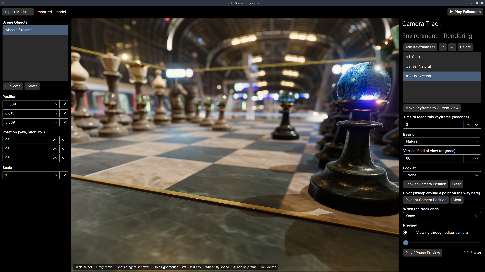
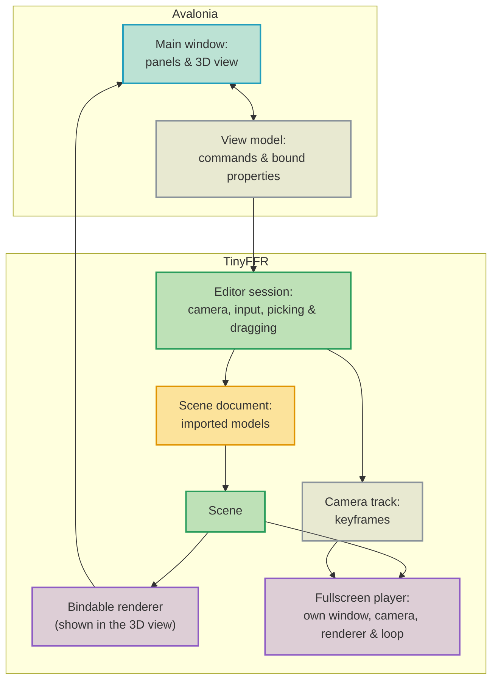

<div class="grid cards" markdown>

-   :octicons-beaker-16:{ : style="margin-right:0.3em" } __Overview__ [__View Code on Github &nbsp; :simple-github:__](https://github.com/Egodystonic/TinyFFR/tree/main/Examples/SceneProgrammer){ : style="position: absolute; right: 1em;" }

	{ align=right : style="max-width:80%; margin: 0em; margin-left: 1em;" }
    
    This uses TinyFFR and [Avalonia](https://avaloniaui.net/) to create simple scene editor + camera programmer.

</div>

## :material-flask-outline: Demonstrated Features

* [:material-book-open-page-variant: Avalonia Integration](../reference/avalonia_integration.md): Embedding TinyFFR in an Avalonia application;
* [:material-book-open-page-variant: Asynchronous Loading](../reference/asynchronous_loading.md) | [:material-book-open-page-variant: Bundled Assets (glTF & Others)](../reference/bundled_assets.md): Importing models asynchronously while the UI stays responsive;
* [:material-book-open-page-variant: Ray Casting, Pixel-Picking, Projecting](../reference/ray_casting_pixel_picking_projecting.md): Selecting objects by clicking on them, and dragging them around the scene;
* [:material-book-open-page-variant: Programmed Camera Controller](../reference/camera_controller_programmed.md): Building a camera "fly-through" with a programmed camera controller, and previewing and scrubbing through it inside the editor;
* [:material-book-open-page-variant: Backdrop Textures](../reference/backdrop_textures.md) | [:material-book-open-page-variant: Exposure & Brightness](../reference/exposure_and_brightness.md): Loading your own HDR/EXR sky, and controlling the backdrop's brightness;
* [:material-book-open-page-variant: Fog](../reference/fog.md) | [:material-book-open-page-variant: Camera Settings](../reference/camera_settings.md#depth-of-field) | [:material-book-open-page-variant: Render Quality](../reference/render_quality.md): Setting up fog, depth of field, and the render quality preset;
* [:material-book-open-page-variant: Point Lights](../reference/point_lights.md) | [:material-book-open-page-variant: Spot Lights](../reference/spot_lights.md): Adding, editing, and removing point lights and spot lights;
* [:material-book-open-page-variant: Creating / Managing Windows](../reference/creating_and_managing_windows.md) | [:material-book-open-page-variant: Application Loops](../reference/application_loops.md): Playing the result back in a separate fullscreen window, rendered entirely by TinyFFR at an uncapped framerate.

## Running It

Download (or clone) the whole [`Examples/SceneProgrammer`](https://github.com/Egodystonic/TinyFFR/tree/main/Examples/SceneProgrammer) folder, then open a terminal in that folder and run `dotnet run -c Release`.

Press __Import Models...__ to add some models to the scene (any format listed in [Loading Meshes](../reference/loading_meshes.md) works; `.glb` files are a good place to start). Then fly the camera to a good starting point, press __K__ to capture a keyframe, and repeat for a few more viewpoints. Finally, press __Play Fullscreen__.

| Action | Control |
| :-- | :-- |
| Select an object | Left click |
| Move the selected object along the ground | Left drag |
| Raise or lower the selected object | Shift + left drag |
| Fly the editor camera | Hold right mouse button + move mouse, W / A / S / D, Q / E (down / up), Left Shift (faster) |
| Change fly speed | Mouse wheel |
| Add a camera keyframe at the current view | K |
| Delete the selected object | Delete |
| Exit fullscreen playback | Escape |

Keyboard controls only reach the 3D view after you've clicked in to it (see [Avalonia Integration](../reference/avalonia_integration.md)).

??? bug "TypeLoadWorkaround.cs (Crash with Exit Code 139)"
	On Linux, a bug in the .NET 9 and .NET 10 runtimes can make this example crash immediately on startup, before any of its code runs. There's no exception or error message; the process simply exits with a "Segmentation fault" (exit code `139`).

	The bug ([dotnet/runtime#130661](https://github.com/dotnet/runtime/issues/130661)) is in how the runtime loads certain struct types, and it's triggered when some of TinyFFR's types (such as model bundles) are used before the types they contain have been loaded. It has been fixed in .NET 11.

	Until then, the example works around it with [`TypeLoadWorkaround.cs`](https://github.com/Egodystonic/TinyFFR/raw/main/Examples/SceneProgrammer/TypeLoadWorkaround.cs), which makes the runtime load TinyFFR's types in a safe order before the program starts (it runs automatically via a [module initializer](https://learn.microsoft.com/en-us/dotnet/csharp/language-reference/attributes/general#moduleinitializer-attribute)).

	Windows and MacOS are not affected.

## Architecture

The application is split in to two halves: the Avalonia side (the window, its panels, and a *view model* that the panels bind to), and the TinyFFR side (the scene, the cameras, and everything that's rendered). The view model is the only part that talks to both:



Both the editor's 3D view and the fullscreen player render the same `Scene`; only the camera and the render target differ.

| File | What it does |
| :-- | :-- |
| `Program.cs` / `App.axaml` | Starts Avalonia. |
| `MainWindow.axaml` | The window's layout: the object list and properties on the left, the 3D view in the middle, and the camera track and environment settings on the right. |
| `MainViewModel.cs` | Everything the window binds to: the commands behind each button, and the properties behind each field. Owns the `EditorSession`. |
| `EditorSession.cs` | The TinyFFR side of the editor: the factory, scene, sun, editor camera, and bindable renderer; plus flying the camera, picking, and dragging. |
| `SceneDocument.cs` / `SceneObject.cs` | The imported models, and each object's position, rotation, and scale. |
| `CameraTrack.cs` | The camera keyframes, and how they're turned in to a programmed camera controller. |
| `EditorOverlay.cs` | Editor-only scene primitives: the ground grid, the selection box, and the drawn camera track. |
| `EnvironmentSettings.cs` | The backdrop (including custom HDR/EXR skies), lighting, sun, fog, and ground settings. |
| `RenderSettings.cs` | The render quality preset and depth of field, applied to both the editor's renderer and the fullscreen player. |
| `FullscreenPlayer.cs` | Plays the camera track in a separate fullscreen window. |
| `SceneLight.cs` | One point or spot light, and its editable settings. |
| `LookAtOption.cs` | One entry in a keyframe's "Look at" list. |

## One Factory, Two Kinds of Window

Normally, an application that embeds TinyFFR in a UI framework creates its factory in [headless mode](../reference/avalonia_integration.md#factory-setup), leaving windows and input entirely to the framework. This example needs one window of its own as well (for fullscreen playback), and only one factory can exist at a time, so it creates an ordinary (non-headless) factory instead:

```csharp
public EditorSession() {
	Factory = new LocalTinyFfrFactory(rendererBuilderConfig: new RendererBuilderConfig { EnableVSync = false });
	Scene = Factory.SceneBuilder.CreateScene();
	Sun = Factory.LightBuilder.CreateDirectionalLight(castsShadows: true, showSunDisc: true);
	Scene.Add(Sun);

	EditorCamera = Factory.CameraBuilder.CreateCamera();
	_flyController = EditorCamera.CreateController<FreeFlyingCameraController>();
	_flyController.Position = new Location(0f, 2f, -6f);
	_flyController.Pitch = Angle.FromDegrees(10f);
	_previewController = EditorCamera.CreateController<ProgrammedCameraController>();
	RecreateRenderer();

	_groundMesh = Factory.MeshBuilder.CreateCuboid(new Cuboid(GroundSize, GroundThickness, GroundSize));
	_groundColorMap = Factory.TextureBuilder.CreateColorMap(new ColorVect(0.4f, 0.4f, 0.4f), includeAlpha: false);
	_groundMaterial = Factory.MaterialBuilder.CreateStandardMaterial(_groundColorMap);
	_ground = Factory.ObjectBuilder.CreateModelInstance(_groundMesh, _groundMaterial, initialPosition: new Location(0f, -GroundThickness * 0.5f, 0f));

	Document = new SceneDocument(Factory, Scene);
	Overlay = new EditorOverlay(Scene);
	Overlay.SetTrack(Track);
	Overlay.SetLights(Document.Lights, null);
	ApplyEnvironment();
}
```

* `EnableVSync = false` lets the fullscreen player render as many frames as the GPU can manage, rather than waiting for the display. It doesn't affect the editor's 3D view, which renders to an off-screen buffer either way.
* The 3D view shows a *bindable* renderer (created in `RecreateRenderer()`), which renders in to a buffer that the `TinyFfrSceneView` control copies on to the screen (see [Avalonia Integration](../reference/avalonia_integration.md)).
* The ground is a large, thin cuboid with a plain grey material. It's added to or removed from the scene by `ApplyEnvironment()`, depending on the Environment tab's "Show ground" setting.

## The Editor Loop

Avalonia owns the application's main loop, so the editor doesn't run a `while` loop of its own. Instead, `StartAvaloniaUiLoop()` ticks a TinyFFR application loop from Avalonia's dispatcher, passing in the latest input from the 3D view:

```csharp
void StartUiLoop() {
	if (_inputSource == null) return;
	_uiLoop = _session.Factory.ApplicationLoopBuilder.StartAvaloniaUiLoop(_inputSource, Tick);
}

void Tick(TimeSpan deltaTime, ILatestInputRetriever input) {
	_session.Tick(deltaTime.AsDeltaTime(), input.KeyboardAndMouse);
	if (!IsPreviewPlaying) return;

	_isUpdatingPreviewTimeFromTick = true;
	PreviewTimeSeconds = Math.Min(_session.PreviewTimeSeconds, TrackLengthSeconds);
	_isUpdatingPreviewTimeFromTick = false;
	if (Wrapping == AnimationWrapStyle.Once && _session.PreviewTimeSeconds >= TrackLengthSeconds) IsPreviewPlaying = false;
}
```

Each tick, the editor session flies the camera, handles picking and dragging, and renders a frame for the 3D view:

```csharp
public void Tick(float deltaTime, ILatestKeyboardAndMouseInputRetriever input) {
	if (IsPreviewing) {
		if (IsPreviewPlaying) _previewController.Progress(deltaTime);
	}
	else {
		UpdateFlyingCamera(deltaTime, input);
		UpdatePickingAndDragging(input);
		if (input.KeyWasPressedThisIteration(KeyboardOrMouseKey.Delete)) DeleteRequested?.Invoke();
		if (input.KeyWasPressedThisIteration(KeyboardOrMouseKey.K)) AddKeyframeRequested?.Invoke();
		Overlay.UpdateSelectionBox();
	}
	_renderer?.Render();
}
```

There's no way to lock the cursor inside an Avalonia control, so the editor only turns the camera while the right mouse button is held (much like most 3D modelling tools), using a [free-flying camera controller](../reference/camera_controller_free_flying.md):

```csharp
void UpdateFlyingCamera(float deltaTime, ILatestKeyboardAndMouseInputRetriever input) {
	if (input.KeyIsCurrentlyDown(KeyboardOrMouseKey.MouseRight)) {
		_flyController.AdjustYawViaMouseCursor(input, LookSensitivityPerPixel);
		_flyController.AdjustPitchViaMouseCursor(input, LookSensitivityPerPixel);

		var speed = input.KeyIsCurrentlyDown(KeyboardOrMouseKey.LeftShift) ? FlySpeed * 3f : FlySpeed;
		_flyController.AdjustPositionViaKeyPress(input, deltaTime, KeyboardOrMouseKey.W, Orientation.Forward, speed);
		_flyController.AdjustPositionViaKeyPress(input, deltaTime, KeyboardOrMouseKey.S, Orientation.Backward, speed);
		_flyController.AdjustPositionViaKeyPress(input, deltaTime, KeyboardOrMouseKey.A, Orientation.Left, speed);
		_flyController.AdjustPositionViaKeyPress(input, deltaTime, KeyboardOrMouseKey.D, Orientation.Right, speed);
		_flyController.AdjustPositionViaKeyPress(input, deltaTime, KeyboardOrMouseKey.E, Orientation.Up, speed);
		_flyController.AdjustPositionViaKeyPress(input, deltaTime, KeyboardOrMouseKey.Q, Orientation.Down, speed);
	}

	if (input.MouseScrollWheelDelta != 0) {
		FlySpeed = Math.Clamp(FlySpeed * MathF.Pow(1.25f, -input.MouseScrollWheelDelta), MinFlySpeed, MaxFlySpeed);
	}
	_flyController.Progress(deltaTime);
}
```

## Importing Models

Models are imported with `LoadBundledAssetAsync()` (see [Asynchronous Loading](../reference/asynchronous_loading.md)), so that the editor keeps rendering and responding while large files load. Because the factory was created on Avalonia's UI thread, each `await` resumes there, so the rest of the method can safely use TinyFFR and update the UI:

```csharp
public async Task<SceneObject> ImportAsync(string filePath, Location groundPoint) {
	if (!_bundlesByPath.TryGetValue(filePath, out var bundle)) {
		bundle = await _factory.AssetLoader.LoadBundledAssetAsync(filePath);
		_bundlesByPath[filePath] = bundle;
	}

	var sceneObject = CreateObject(Path.GetFileNameWithoutExtension(filePath), bundle);
	var boundingBox = bundle.CalculateCombinedBoundingBox();
	var largestDimension = MathF.Max(boundingBox.Width, MathF.Max(boundingBox.Height, boundingBox.Depth));
	var scale = largestDimension is > 0.1f and < 25f ? 1f : ImportedModelTargetSize / largestDimension;
	var bottom = boundingBox.Position.Y - boundingBox.HalfHeight;
	sceneObject.Scale = Math.Round((decimal) scale, 4);
	sceneObject.Position = new Location(groundPoint.X, groundPoint.Y - bottom * scale, groundPoint.Z);
	return sceneObject;
}
```

* Importing the same file twice re-uses the already-loaded [model bundle](../reference/bundled_assets.md); only a new group of model instances is created.
* Models are often authored in centimetres, or at the size of a whole city. Anything unreasonably large or small is scaled to around two metres across when it's imported (the scale can be changed afterwards in the properties panel).
* Each new object is placed on the ground in the middle of the view (see `GetPlacementPointInView()` in `EditorSession.cs`).

## Selecting & Dragging

Clicking in the 3D view uses [pixel picking](../reference/ray_casting_pixel_picking_projecting.md) to find which model instance is under the cursor, and the scene document maps that instance back to the object it belongs to. Dragging then moves the object across a horizontal plane at the height where it was grabbed, using a ray cast from the cursor:

```csharp
void UpdatePickingAndDragging(ILatestKeyboardAndMouseInputRetriever input) {
	if (input.KeyWasPressedThisIteration(KeyboardOrMouseKey.MouseLeft)) {
		var pick = EditorRenderer.PickModelInstanceFromRenderSurface(input.MouseCursorPosition);
		var picked = pick is { } p ? Document.FindOwner(p.ModelInstance) : null;
		Selection = picked;
		SelectionPicked?.Invoke(picked);
		if (picked != null && pick is { } hit) {
			_isDragging = true;
			_dragPlaneHeight = hit.Position.Y;
			_dragOffset = picked.Position.AsVect() - hit.Position.AsVect();
		}
		return;
	}

	if (!_isDragging || _selection == null) return;
	if (!input.KeyIsCurrentlyDown(KeyboardOrMouseKey.MouseLeft)) {
		_isDragging = false;
		return;
	}
	if (input.MouseCursorDelta == XYPair<int>.Zero) return;

	if (input.KeyIsCurrentlyDown(KeyboardOrMouseKey.LeftShift)) {
		var distance = EditorCamera.Position.DistanceFrom(_selection.Position);
		var rise = -input.MouseCursorDelta.Y * distance * 0.0025f;
		_dragPlaneHeight += rise;
		_selection.Position += new Vect(0f, rise, 0f);
		return;
	}

	var ray = EditorRenderer.CreateRayFromRenderSurface(input.MouseCursorPosition);
	if (ray.IntersectionWith(new Plane(Direction.Up, new Location(0f, _dragPlaneHeight, 0f))) is not { } groundHit) return;
	if (groundHit.DistanceFrom(EditorCamera.Position) > 500f) return;
	var target = groundHit + _dragOffset;
	_selection.Position = new Location(target.X, _selection.Position.Y, target.Z);
}
```

* Remembering the offset between the grab point and the object's position (`_dragOffset`) stops the object from jumping so that its origin sits under the cursor.
* Holding Shift instead raises or lowers the object, by an amount that grows with its distance from the camera, so that dragging feels about the same whether the object is near or far.

## Editor Overlay

The ground grid, the selection box, and the camera track are all drawn with [scene primitives](../reference/scene_primitives.md). The track is redrawn whenever a keyframe changes: a line between each pair of keyframes (or a curve, sampled from the same formula the controller uses, when the keyframe has a pivot), an arrow showing where the camera faces (pink when it's looking at something), the keyframe's number, and markers for any pivots and look-at points:

```csharp
public void RebuildPath() {
	ClearPath();
	if (!_isVisible || _track == null) return;

	var keyframes = _track.Keyframes;
	for (var i = 0; i < keyframes.Count; ++i) {
		var keyframe = keyframes[i];
		if (i > 0) AddPathSegment(keyframes[i - 1].Position, keyframe);
		var lookAt = keyframe.LookAtLocation;
		_pathPrimitives.Add(_scene.AddPrimitiveArrow(keyframe.Position, keyframe.GetViewDirection(), lookAt != null ? LookBrush : PathBrush, ScenePrimitiveSize.Medium));
		_pathPrimitives.Add(_scene.AddPrimitiveString(keyframe.Position + new Vect(0f, 0.25f, 0f), keyframe.Number.ToString(), PathBrush));
		if (keyframe.LookAt == LookAtOption.Point && lookAt is { } lookAtPoint) {
			_pathPrimitives.Add(_scene.AddPrimitivePoint(lookAtPoint, LookBrush, ScenePrimitiveSize.Medium));
			_pathPrimitives.Add(_scene.AddPrimitiveShape(new BoundedRay(keyframe.Position, lookAtPoint), LookBrush, ScenePrimitiveSize.VerySmall, includeEndpoints: false));
		}
	}
}

void AddPathSegment(Location start, CameraKeyframe keyframe) {
	var end = keyframe.Position;
	if (keyframe.PivotPoint is not { } pivot) {
		_pathPrimitives.Add(_scene.AddPrimitiveShape(new BoundedRay(start, end), PathBrush, includeEndpoints: false));
		return;
	}

	_pathPrimitives.Add(_scene.AddPrimitivePoint(pivot, PivotBrush, ScenePrimitiveSize.Medium));
	var startVect = start - pivot;
	var endVect = end - pivot;
	var previous = start;
	for (var step = 1; step <= ArcSegmentCount; ++step) {
		var fraction = step / (float) ArcSegmentCount;
		var length = startVect.Length + (endVect.Length - startVect.Length) * fraction;
		var next = startVect.Direction == Direction.None || endVect.Direction == Direction.None
			? start + (end - start) * fraction
			: pivot + Direction.Interpolate(startVect.Direction, endVect.Direction, fraction) * length;
		_pathPrimitives.Add(_scene.AddPrimitiveShape(new BoundedRay(previous, next), PathBrush, includeEndpoints: false));
		previous = next;
	}
}
```

Primitives are part of the scene, so they'd also appear in the fullscreen player and in the preview. The overlay therefore removes them all while either is running, and adds them back afterwards (`SetVisible()`).

## Building the Camera Track

Each keyframe stores a camera position, view and up directions, and field of view, captured from the editor camera; plus how long the camera should take to reach it, the easing to use on the way, and optionally:

* Something to look at: either an object, or a point. To set a point, fly the editor camera to the spot the keyframe should look at and press __Look at Camera Position__.
* A *pivot*: a point the camera sweeps around in an arc on its way to the keyframe, rather than travelling in a straight line. It's set the same way, with __Pivot at Camera Position__.

Both can be removed again with their __Clear__ buttons.

A [programmed camera controller](../reference/camera_controller_programmed.md) can only have keyframes appended to it, so whenever the track is played or previewed, it's rebuilt from scratch:

```csharp
public void ApplyTo(ProgrammedCameraController controller) {
	controller.ResetParametersToDefault();
	if (Keyframes.Count == 0) return;

	var camera = controller.Camera;
	var start = Keyframes[0];
	camera.Position = start.Position;
	camera.SetViewAndUpDirection(start.GetViewDirection(), start.UpDirection);
	camera.SetVerticalFieldOfView(Angle.FromDegrees((float) start.FieldOfViewDegrees));

	for (var i = 1; i < Keyframes.Count; ++i) {
		var keyframe = Keyframes[i];
		var length = (float) keyframe.DurationSeconds;
		controller.AddPositionKeyframe(keyframe.PivotPoint is { } pivot
			? new(length, GetAlgorithm<Location>(keyframe.Easing), keyframe.Position, pivot)
			: new(length, GetAlgorithm<Location>(keyframe.Easing), keyframe.Position)
		);
		controller.AddOrientationKeyframe(keyframe.LookAtLocation is { } target
			? new(length, GetAlgorithm<Direction>(keyframe.Easing), target, keyframe.UpDirection)
			: new(length, GetAlgorithm<Direction>(keyframe.Easing), keyframe.ViewDirection, keyframe.UpDirection)
		);
		controller.AddFieldOfViewKeyframe(new(length, GetAlgorithm<Angle>(keyframe.Easing), Angle.FromDegrees((float) keyframe.FieldOfViewDegrees)));
	}

	controller.PositionTrackWrapping = Wrapping;
	controller.OrientationTrackWrapping = Wrapping;
	controller.FieldOfViewTrackWrapping = Wrapping;
	controller.Progress(0f);
}
```

* The first keyframe is the camera's starting pose; it isn't added to the controller at all. Instead, the camera is moved there before the first `Progress()` call, because the controller captures the camera's current position, orientation, and field of view as its starting values when its timestamp is zero.
* Every later keyframe adds one position, one orientation, and one field-of-view keyframe, all the same length, so the three tracks stay in step.
* When a keyframe looks at an object or a point, its orientation keyframe uses that location (an object's centre) as a *look-at target* instead of a fixed direction. The camera then keeps facing it even while moving past it.
* When a keyframe has a pivot, its position keyframe is created with that `Pivot`. The camera then turns around the pivot along the shortest arc (so one keyframe can sweep at most 180°), while its distance from the pivot changes gradually from the starting distance to the ending one.
* Each easing style maps on to one of the built-in [interpolation algorithms](../reference/interpolation_algorithms.md).

## Previewing in the Editor

The preview doesn't need its own renderer: a camera can have more than one controller attached, and each one only moves the camera when it's progressed. So the preview attaches a programmed camera controller to the *editor* camera, and simply stops progressing the free-flying one while it's active:

```csharp
public void EnterPreview(float timeSeconds) {
	if (!IsPreviewing) _editorFieldOfView = EditorCamera.VerticalFieldOfView;
	IsPreviewing = true;
	IsPreviewPlaying = false;
	Overlay.SetVisible(false);
	SeekPreview(timeSeconds);
}

public void ExitPreview() {
	if (IsPreviewing) EditorCamera.SetVerticalFieldOfView(_editorFieldOfView);
	IsPreviewing = false;
	IsPreviewPlaying = false;
	Overlay.SetVisible(true);
}

public void SeekPreview(float timeSeconds) {
	Track.ApplyTo(_previewController);
	_previewController.CurrentTimestampSeconds = timeSeconds;
	_previewController.Progress(0f);
}
```

* Scrubbing rebuilds the track and then jumps straight to the chosen time with `CurrentTimestampSeconds`.
* When the preview ends, the free-flying controller's next `Progress()` call puts the camera back where it was; only the field of view needs restoring by hand, because the free-flying controller doesn't control it.

## Fullscreen Playback

Pressing __Play Fullscreen__ creates a fullscreen TinyFFR window with its own camera, renderer, and application loop, and runs a plain `while` loop until the track ends or the user presses Escape:

```csharp
public static PlaybackSummary Play(EditorSession session) {
	var factory = session.Factory;
	var display = factory.DisplayDiscoverer.Primary ?? throw new InvalidOperationException("No display connected.");

	using var window = factory.WindowBuilder.CreateWindow(display, WindowFullscreenStyle.FullscreenBorderless, title: "Scene Programmer");
	using var camera = factory.CameraBuilder.CreateCamera();
	using var controller = camera.CreateController<ProgrammedCameraController>();
	using var renderer = factory.RendererBuilder.CreateRenderer(session.Scene, camera, window);
	using var loop = factory.ApplicationLoopBuilder.CreateLoop(new LocalApplicationLoopCreationConfig {
		FrameRateCapHz = null,
		IterationShouldPumpSystemEventQueue = true
	});

	window.LockCursor = true;
	camera.Exposure = session.Environment.Exposure;
	session.Rendering.ApplyTo(renderer, camera);
	session.Track.ApplyTo(controller);

	var endTime = session.Track.PlaybackLengthSeconds + HoldOnFinalFrameSeconds;
	var elapsed = 0f;
	var frameCount = 0;
	while (true) {
		var deltaTime = loop.IterateOnce().AsDeltaTime();
		var input = loop.Input;
		if (input.UserQuitRequested || input.KeyboardAndMouse.KeyWasPressedThisIteration(KeyboardOrMouseKey.Escape) || elapsed >= endTime) break;

		elapsed += deltaTime;
		controller.Progress(deltaTime);
		renderer.Render();
		++frameCount;
	}

	return new PlaybackSummary(elapsed, frameCount);
}
```

* This loop blocks Avalonia's UI thread, so the editor is frozen while it runs. That's deliberate: nothing else needs to happen while the track plays, and it means every bit of the CPU and GPU goes towards the fullscreen window.
* The loop sets `IterationShouldPumpSystemEventQueue = true`, because the editor's own loop doesn't read the operating system's event queue (Avalonia does that), but this window's input and close events only arrive if someone does (see [Application Loops](../reference/application_loops.md)).
* Window, camera, renderer, and loop are all disposed when the method returns, so playback can be started again as many times as you like.

Before playing, the view model stops the editor's loop, unbinds and disposes the editor's renderer, and hides the overlay; and afterwards puts everything back:

```csharp
void PlayFullscreen() {
	if (!CanPlay) return;
	IsPreviewing = false;
	_uiLoop?.Dispose();
	_uiLoop = null;
	ActiveRenderer = null;
	_session.ReleaseRenderer();
	_session.Overlay.SetVisible(false);
	try {
		var summary = FullscreenPlayer.Play(_session);
		StatusText = $"Played {summary.DurationSeconds:N1}s at an average of {summary.AverageFramesPerSecond:N0} FPS.";
	}
	catch (Exception e) {
		StatusText = $"Playback failed: {e.GetBaseException().Message}";
	}
	finally {
		_session.Overlay.SetVisible(true);
		ActiveRenderer = _session.RecreateRenderer();
		StartUiLoop();
	}
}
```

Releasing the editor's renderer frees its GPU memory (render targets at the size of the 3D view) for the fullscreen window's 4K-sized ones. In testing, with the chess set from [Loading Assets](loading_assets.md) and two helmets in the scene, the application used around 1.6 GB of VRAM while editing and around 2.2 GB during 3840 × 2160 fullscreen playback, which ran at around 380 to 420 frames per second.

## Environment

The Environment tab sets the scene's [backdrop](../reference/scenes.md#backdrops), the sun's direction and brightness (see [Directional Lights](../reference/directional_lights.md)), and whether there's a ground to stand things on. Choosing a lighting preset sets the backdrop brightness, the sun's brightness, and the camera's [exposure](../reference/exposure_and_brightness.md) together, so that the scene is always correctly exposed:

```csharp
public void ApplyTo(Scene scene, DirectionalLight sun) {
	switch (Backdrop) {
		case BackdropStyle.Clouds:
			scene.SetBackdrop(BuiltInSceneBackdrop.Clouds, BackdropBrightness);
			break;
		case BackdropStyle.Starfield:
			scene.SetBackdrop(BuiltInSceneBackdrop.Starfield, BackdropBrightness);
			break;
		case BackdropStyle.SkyColor:
			scene.SetBackdrop(SkyColor, BackdropBrightness);
			break;
		case BackdropStyle.CustomHdr when CustomBackdrop is { } custom:
			if (UseBackdropBrightnessSlider) {
				var lux = GetMatchingBackdropBrightness(Lighting).ToLux() * BackdropBrightnessPercent / 100f;
				scene.SetBackdrop(custom, custom.LuxToIntensity(lux));
			}
			else {
				scene.SetBackdrop(custom, BackdropBrightness);
			}
			break;
		default:
			scene.RemoveBackdrop();
			break;
	}

	if (Fog is { } fog) scene.AddFog(fog);
	else scene.RemoveFog();

	sun.SetBrightness(SunBrightness.ToBrightnessValue() * SunBrightnessMultiplier);
	sun.Color = SunColor;
	sun.Direction = SunDirection;
	sun.CastsShadows = SunCastsShadows;
}
```

The sun's brightness can also be scaled (relative to the lighting preset's brightness, so `1×` stays correctly exposed) and tinted with a colour picker; as with every other light colour, the picked sRGB colour is converted to a linear one for the light. The ground grid is part of the [editor overlay](#editor-overlay), so it can be hidden with "Show grid" without affecting the preview or fullscreen playback (where it's never shown anyway).

The fullscreen player's camera copies the same exposure when it's created.

### Backdrop Brightness

Choosing a lighting preset also sets the backdrop brightness to match, but the "Backdrop brightness" setting can then be changed independently, to any [`SceneBackdropBrightnessPreset`](../reference/exposure_and_brightness.md#backdrops) (for example, a darker sky over a brightly-lit scene).

For a custom HDR/EXR backdrop, the brightness can also be set with a slider. The slider scales the backdrop relative to the lighting preset's brightness (so 100% is correctly exposed), using the backdrop's `MeasuredLux` to convert a brightness in lux to the intensity value that `SetBackdrop()` expects (via `LuxToIntensity()`). TinyFFR doesn't expose the measured brightness of its built-in backdrops or of colour backdrops, so for those, only the presets are available.

### Custom HDR/EXR Backdrops

__Load HDR/EXR...__ converts a high-dynamic-range image in to a [backdrop texture](../reference/backdrop_textures.md), at the resolution chosen next to the button:

```csharp
public async Task LoadCustomBackdropAsync(string filePath) {
	IsBusy = true;
	try {
		StatusText = $"Converting {Path.GetFileName(filePath)} to a backdrop at {HdrQuality} quality (this can take a minute or more)...";
		var backdrop = await _session.Factory.AssetLoader.LoadBackdropTextureAsync(filePath, HdrQuality);
		_session.SetCustomBackdrop(backdrop);
		if (!BackdropStyles.Contains(BackdropStyle.CustomHdr)) BackdropStyles.Insert(3, BackdropStyle.CustomHdr);
		CustomBackdropName = $"Custom HDR: {Path.GetFileName(filePath)} ({HdrQuality})";
		Backdrop = BackdropStyle.CustomHdr;
		StatusText = $"Loaded backdrop {Path.GetFileName(filePath)}.";
	}
	catch (Exception e) {
		StatusText = $"Backdrop load failed: {e.GetBaseException().Message}";
	}
	finally {
		IsBusy = false;
	}
}
```

* Converting an HDR image is slow (it can take minutes at the highest resolutions), so it's done asynchronously: the editor keeps rendering while the conversion runs in the background. In testing, a 4K HDR image converted in under two seconds at `Quality.Low`.
* Loading a second backdrop replaces the first; `SetCustomBackdrop()` (in `EditorSession.cs`) only disposes the old backdrop texture after the scene has switched to the new one, because a backdrop texture can't be disposed while a scene is still using it.
* In a real application, you'd convert backdrops ahead of time instead (by preprocessing or baking them; see [Backdrop Textures](../reference/backdrop_textures.md)), so they load in moments.

### Fog

The fog panel edits every property of a [`FogDescriptor`](../reference/fog.md#custom-fog). __Apply Preset__ fills the panel in from one of the `FogDensity` presets, which is a good starting point for adjusting from:

```csharp
void LoadFogPreset(FogDensity preset) {
	var fog = new FogDescriptor(preset);
	var srgb = ColorVect.LinearToSrgb(fog.Color);
	_isLoadingFogPreset = true;
	FogColor = Color.FromRgb((byte) Math.Round(srgb.Red * 255f), (byte) Math.Round(srgb.Green * 255f), (byte) Math.Round(srgb.Blue * 255f));
	FogOpacity = fog.Color.Alpha;
	FogDensityMultiplier = fog.DensityMultiplier;
	FogStartDistance = fog.StartDistance;
	FogGroundLayerHeight = fog.GroundLayerHeight;
	FogSkywardFalloff = fog.SkywardDensityFalloffMultiplier;
	FogSunScattering = fog.DirectionalLightScatteringStrengthMultiplier;
	FogOccludesBackdrop = fog.OccludesBackdrop;
	_isLoadingFogPreset = false;
}

FogDescriptor CreateFogDescriptor() {
	var linear = ColorVect.SrgbToLinear(new ColorVect(FogColor.R / 255f, FogColor.G / 255f, FogColor.B / 255f));
	return new FogDescriptor {
		Color = new ColorVect(linear.Red, linear.Green, linear.Blue, (float) FogOpacity),
		DensityMultiplier = (float) FogDensityMultiplier,
		StartDistance = (float) FogStartDistance,
		GroundLayerHeight = (float) FogGroundLayerHeight,
		SkywardDensityFalloffMultiplier = (float) FogSkywardFalloff,
		DirectionalLightScatteringStrengthMultiplier = (float) FogSunScattering,
		OccludesBackdrop = FogOccludesBackdrop
	};
}
```

Fog colours are linear (like every lighting colour in TinyFFR; see [Colour](../reference/colour.md)), but the colour picker works in the sRGB colours you'd see in an image editor. So the colour is converted with `ColorVect.SrgbToLinear()` on its way in to the descriptor, and with `ColorVect.LinearToSrgb()` when a preset's colour is shown in the picker. The picker's alpha channel is turned off; the fog's opacity has its own slider instead, which goes in to the colour's alpha.

The fog is part of the scene, so the fullscreen player shows it too.

## Lights

The Lights tab adds [point lights](../reference/point_lights.md) and [spot lights](../reference/spot_lights.md) to the scene. A new light is placed at the editor camera's position (and a new spot light points wherever the camera is looking), so the easiest way to place one is to fly to where it should be first. Each light is wrapped in a `SceneLight`, which applies its settings to the underlying light whenever one of them changes:

```csharp
void Apply() {
	var multiplier = (float) Math.Max(BrightnessMultiplier, 0d);
	var range = Math.Max((float) Range, 0.1f);
	if (_pointLight is { } pointLight) {
		pointLight.Position = Position;
		pointLight.Color = LinearColor;
		pointLight.Brightness = PointBrightnessPreset.ToBrightnessValue() * multiplier;
		pointLight.CastsShadows = CastsShadows;
		pointLight.MaxIlluminationRadius = range;
	}
	if (_spotLight is { } spotLight) {
		spotLight.Position = Position;
		spotLight.Color = LinearColor;
		spotLight.Brightness = SpotBrightnessPreset.ToBrightnessValue() * multiplier;
		spotLight.CastsShadows = CastsShadows;
		spotLight.MaxIlluminationDistance = range;
		spotLight.ConeAngle = Angle.FromDegrees((float) ConeAngleDegrees);
		spotLight.IntenseBeamAngle = Angle.FromDegrees((float) Math.Min(IntenseBeamAngleDegrees, ConeAngleDegrees));
	}
}
```

* Brightness is chosen as one of the built-in brightness presets (such as `BulbTypical` or `DeskLamp`), times a multiplier.
* As with the fog colour, the colour picker's sRGB colour is converted to a linear one for the light.
* A spot light can be aimed along the camera's view, or at the selected object. The light's own position and direction are shown in the editor with scene primitives (in the light's colour), and the selected light is outlined.
* Lights use real-world brightness, so a household bulb hardly shows up at all under the `Midday` lighting preset, just as it wouldn't outdoors on a sunny day (see [Exposure & Brightness](../reference/exposure_and_brightness.md)). They're most effective with the `Twilight` or `Indoors` presets.

## Rendering

The Rendering tab sets the [render quality](../reference/render_quality.md) preset and the camera's [depth of field](../reference/camera_settings.md#depth-of-field). Both apply to the editor's view and to fullscreen playback, so what you see while editing is what you'll get:

```csharp
public void ApplyTo(Renderer renderer, Camera camera) {
	renderer.SetQuality(new RenderQualityConfig(Quality) { DepthOfFieldStrength = DepthOfFieldStrength });
	camera.FocusDistance = DepthOfFieldEnabled ? FocusDistance : null;
}
```

* A camera's `FocusDistance` is `null` when depth of field is off; setting it to a distance in metres turns the effect on. __Focus on Selected Object__ sets it to the selected object's current distance from the editor camera.
* The blur strength is the quality config's `DepthOfFieldStrength`. (The camera's aperture also affects the blur, but the aperture is set by the lighting preset's exposure.)
* The focus distance stays the same for the whole camera track. In testing, depth of field, thick fog, and the `VeryHigh` preset together brought fullscreen playback down from around 345 to around 210 frames per second at 3840 × 2160; depth of field is the most expensive effect in TinyFFR.

## Avoiding Garbage

Avalonia (like most UI frameworks) allocates memory as it runs, so the editor doesn't try to avoid generating garbage. The fullscreen player's loop, however, allocates nothing at all: in testing, three runs of around 2,500 frames each allocated zero bytes after the first second. Combined with the uncapped framerate, this keeps playback as smooth as possible (see [Avoiding GC Stutter](../reference/avoiding_gc_stutter.md)).
