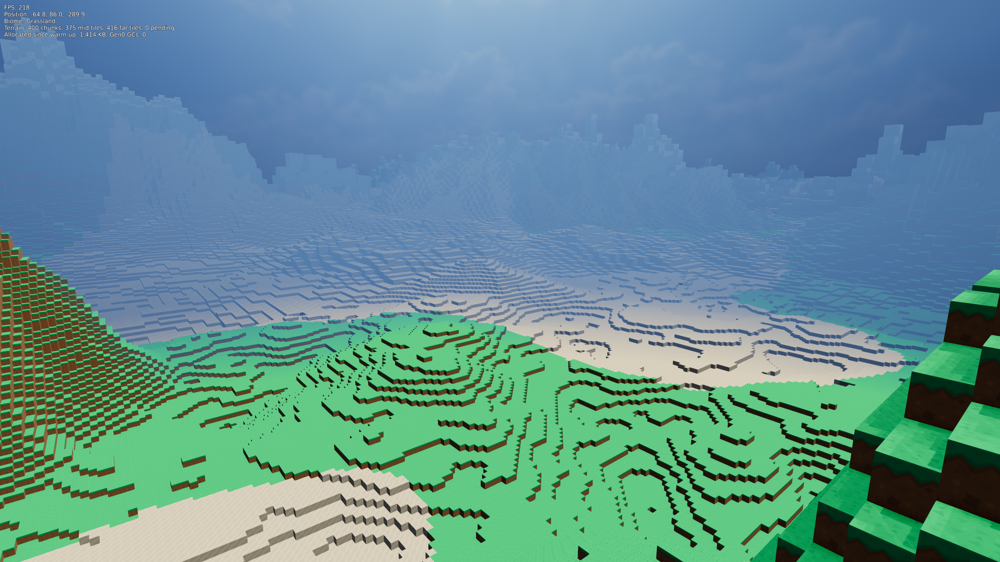
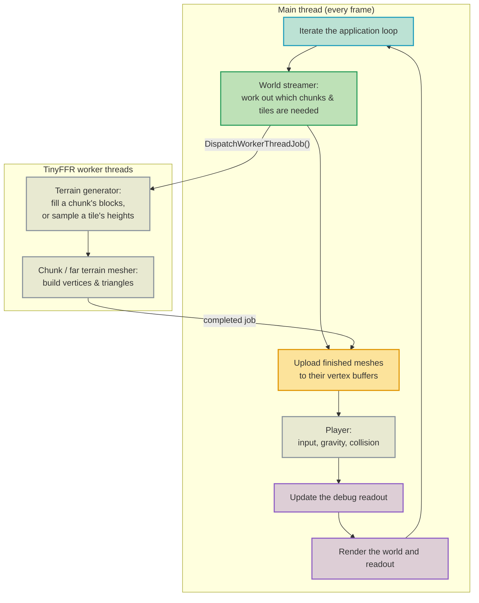

<div class="grid cards" markdown>

-   :octicons-beaker-16:{ : style="margin-right:0.3em" } __Overview__ [__View Code on Github &nbsp; :simple-github:__](https://github.com/Egodystonic/TinyFFR/tree/main/Examples/VoxelWorld){ : style="position: absolute; right: 1em;" }

    { align=right : style="max-width:80%; margin: 0em; margin-left: 1em;" }
    
    This uses TinyFFR to demonstrate a simulated voxel-based game world.

</div>

## :material-flask-outline: Demonstrated Features

* [:material-book-open-page-variant: Dynamic Meshes & Mutable Grids](../reference/dynamic_meshes_and_mutable_grids.md#dynamic-vertex-buffers): Writing generated geometry in to dynamic vertex buffers, and re-using them as the world streams in and out;
* [:material-book-open-page-variant: First-Person Camera Controller](../reference/camera_controller_first_person.md): Looking around with a first-person camera controller;
* [:material-book-open-page-variant: Keyboard / Mouse Input](../reference/keyboard_and_mouse_input.md) | [:material-book-open-page-variant: Gamepad Input](../reference/gamepad_input.md): Keyboard, mouse, and gamepad controls;
* [:material-book-open-page-variant: Directional Lights](../reference/directional_lights.md) | [:material-book-open-page-variant: Fog](../reference/fog.md): A sun with shadows, and distance fog;
* [:material-book-open-page-variant: Canvas Scenes (2D)](../reference/canvas_scenes.md): A 2D debug readout drawn over the 3D scene;
* [:material-book-open-page-variant: Avoiding GC Stutter](../reference/avoiding_gc_stutter.md): Keeping the application free of garbage collection pauses after start-up.

## Running It

Download (or clone) the whole [`Examples/VoxelWorld`](https://github.com/Egodystonic/TinyFFR/tree/main/Examples/VoxelWorld) folder, then open a terminal in that folder and run `dotnet run -c Release`.

Every world is generated from a *seed* number; the same seed always produces the same world. To explore a different world, pass a seed after `--`; for example: `dotnet run -c Release -- 1234`.

| Action | Keyboard & Mouse | Gamepad |
| :-- | :-- | :-- |
| Look around | Mouse | Right stick |
| Move | W / A / S / D | Left stick |
| Sprint | Left Shift (hold) | Left stick button (hold) |
| Jump | Space | A |
| Exit | Escape | |

You can walk up single blocks without jumping, and jump up ledges two blocks high.

??? bug "TypeLoadWorkaround.cs (Crash with Exit Code 139)"
	On Linux, a bug in the .NET 9 and .NET 10 runtimes can make this example crash immediately on startup, before any of its code runs. There's no exception or error message; the process simply exits with a "Segmentation fault" (exit code `139`).

	The bug ([dotnet/runtime#130661](https://github.com/dotnet/runtime/issues/130661)) is in how the runtime loads certain struct types, and it's triggered when a program's `Main` method (including top-level statements like this example's `Program.cs`) uses some of TinyFFR's types before the types they contain have been loaded; such as canvas scenes, canvas images and text, and model bundles. It has been fixed in .NET 11.

	Until then, the example works around it with [`TypeLoadWorkaround.cs`](https://github.com/Egodystonic/TinyFFR/raw/main/Examples/VoxelWorld/TypeLoadWorkaround.cs), which makes the runtime load TinyFFR's types in a safe order before the program starts (it runs automatically via a [module initializer](https://learn.microsoft.com/en-us/dotnet/csharp/language-reference/attributes/general#moduleinitializer-attribute)).

	Windows and MacOS are not affected.

## Architecture

The world is divided in to *chunks*: columns of 16 × 16 blocks, 256 blocks tall. Chunks are grouped in to *regions* of 4 × 4 chunks (64 × 64 blocks), and regions in to *super-regions* of 4 × 4 regions (256 × 256 blocks).

The terrain is drawn at three levels of detail (see [Distant Terrain](#distant-terrain)):

| Level | Drawn as | Covers |
| :-- | :-- | :-- |
| Near | Full-detail block chunks | The 5 × 5 regions around the player (around ±150 m) |
| Mid | One low-detail mesh per region, built from cells of 4 × 4 blocks | The 5 × 5 super-regions around the player (around ±600 m) |
| Far | One low-detail mesh per super-region, built from cells of 16 × 16 blocks | Out to 10 super-regions away (around ±2.5 km) |

As the player moves, chunks and tiles that fall too far behind are removed and their resources re-used for new ones ahead.

The expensive work (generating each chunk's blocks and building its mesh) happens on TinyFFR's background *worker* threads, so that the main thread can keep rendering frames smoothly. The main thread only hands out jobs, uploads finished meshes to the GPU, moves the player, and renders:



This is the "Streaming Open World" pattern from [Scaling Up: Application Flow](application_flow.md#streaming-open-world), except that the work here is generating data rather than loading asset files, so instead of TinyFFR's [asynchronous loading](../reference/asynchronous_loading.md) functions, the example hands its own jobs to the same worker threads TinyFFR uses for asynchronous loading.

The code is split in to one file per responsibility:

| File | Responsibility |
| :-- | :-- |
| `Program.cs` | Creates every resource, runs the application loop, and disposes everything at the end. |
| `WorldSettings.cs` | Constants that control the world (chunk size, render distance, seed, etc.); a good place to start tinkering. |
| `BlockType.cs` | The kinds of block, and which part of the texture atlas each face of each block uses. |
| `Noise.cs` | Seeded 2D noise, used to generate the terrain's shape. |
| `TerrainGenerator.cs` | Decides each column's height and biome, and fills a chunk's blocks. |
| `TerrainMesh.cs` | Mesh data shared by both meshers, and the code that writes one textured square (quad) in to it. |
| `ChunkMesher.cs` | Turns a chunk's blocks in to vertices and triangles. |
| `FarTerrainMesher.cs` | Builds a low-detail terrain tile's mesh straight from the terrain generator's heights. |
| `TerrainJobScheduler.cs` | Sends terrain jobs to TinyFFR's worker threads, and collects the finished results. |
| `Chunk.cs` / `TerrainTile.cs` / `Region.cs` | One chunk's blocks, one low-detail terrain tile, and coordinate types. Chunks and tiles each have a `GpuMeshSlot`. |
| `GpuMeshSlot.cs` | One dynamic vertex buffer, the mesh drawing it, and the model instance placing it in the scene. |
| `ChunkManager.cs` | The near level: decides which full-detail chunks are needed, and answers "is this block solid?" for collision. |
| `TerrainLevel.cs` | One low-detail level (used for both the mid and far levels): decides which of its tiles are needed and visible. |
| `WorldStreamer.cs` | Ties the three levels together, and hands each finished mesh to the level that asked for it. |
| `Player.cs` | Mouse/gamepad look, movement, gravity, jumping, and collision. |
| `DebugHud.cs` | The 2D readout in the top-left corner. |
| `TypeLoadWorkaround.cs` | A workaround for a .NET runtime bug (see [above](#running-it)). |

## Terrain Generation

Each column of the world gets a height from several layers of [noise](https://en.wikipedia.org/wiki/Simplex_noise) added together: broad, gentle "continent" variation, smaller hills, ridged mountains that only rise where a separate "mountain mask" noise allows them, and much larger (but rarer) mountain ranges that rise over 200 blocks high, so that the horizon is usually broken up by distant peaks:

```csharp
int ComputeSurfaceHeight(float worldX, float worldZ, float temperature, out float mountainHeight) {
	var desertFactor = SmoothStep(0.1f, DesertTemperature + 0.15f, temperature);
	var coldFactor = SmoothStep(-0.1f, -(DesertTemperature + 0.15f), temperature);

	var continent = _continent.SampleFractal(worldX * 0.0025f, worldZ * 0.0025f, 3) * 14f;
	var hills = _hills.SampleFractal(worldX * 0.012f, worldZ * 0.012f, 4) * 9f * (1f - 0.6f * desertFactor);

	var mountainMask = SmoothStep(0.05f, 0.55f, _mountainMask.SampleFractal(worldX * 0.0035f, worldZ * 0.0035f, 2) + coldFactor * 0.3f);
	var ridge = 1f - MathF.Abs(_ridges.SampleFractal(worldX * 0.007f, worldZ * 0.007f, 4));
	mountainHeight = ridge * ridge * 62f * mountainMask * (1f - 0.75f * desertFactor);

	var rangeMask = SmoothStep(0.05f, 0.45f, _rangeMask.SampleFractal(worldX * 0.0007f, worldZ * 0.0007f, 2));
	var rangeRidge = 1f - MathF.Abs(_rangeRidges.SampleFractal(worldX * 0.0028f, worldZ * 0.0028f, 5));
	mountainHeight += rangeRidge * rangeRidge * rangeRidge * 130f * rangeMask * (1f - 0.5f * desertFactor);

	var height = BaseHeight + continent + hills + mountainHeight;
	return Math.Clamp((int) height, 1, WorldSettings.ChunkHeight - 2);
}
```

Biomes are chosen by a slowly-varying *temperature* noise: warm areas become desert, cold areas become snowfields, and everything in between is grassland. Rather than switching abruptly at biome borders, the temperature also smoothly scales the hills and mountains (flatter in the desert, more mountainous in the cold), so the terrain's shape never has a cliff where one biome meets another. Only the choice of surface block (grass, sand, snow, exposed stone on high peaks) switches at a threshold.

Because the noise is a pure function of position and seed, any column's height can be worked out at any time without generating anything else. The generator relies on this to make chunks independent of each other: it generates a one-block border around every chunk (belonging to its neighbours), so that the mesher can tell which faces at the chunk's edges are hidden without waiting for the neighbouring chunks to be generated.

## Chunk Meshing

Most blocks are completely surrounded by other blocks, and therefore can't be seen. The mesher only creates a square (two triangles) for each block face that touches air:

```csharp
for (var x = 0; x < WorldSettings.ChunkSize; ++x) {
	for (var z = 0; z < WorldSettings.ChunkSize; ++z) {
		var columnTop = borderedColumnHeights[(x + 1) * TerrainGenerator.BorderedChunkSize + (z + 1)];
		for (var y = 0; y <= columnTop; ++y) {
			var block = borderedBlocks[TerrainGenerator.GetBlockIndex(x + 1, y, z + 1)];
			if (block == BlockType.Air) continue;

			for (var f = 0; f < faces.Length; ++f) {
				ref readonly var face = ref faces[f];
				var neighbourY = y + face.NormalY;
				if (neighbourY < 0) continue;
				if (neighbourY < WorldSettings.ChunkHeight) {
					var neighbour = borderedBlocks[TerrainGenerator.GetBlockIndex(x + 1 + face.NormalX, neighbourY, z + 1 + face.NormalZ)];
					if (neighbour != BlockType.Air) continue;
				}

				var faceCentre = new Vector3(x + 0.5f + face.NormalX * 0.5f, y + 0.5f + face.NormalY * 0.5f, z + 0.5f + face.NormalZ * 0.5f);
				if (!TerrainMeshWriter.TryAddQuad(output, faceCentre, in face, 1f, 1f, BlockTextures.GetTile(block, face.Face))) return;
			}
		}
	}
}
```

Each face's vertices are given a position, texture coordinates (pointing at the right tile in the texture atlas), and a tangent rotation describing which way the face points (see [Creating Meshes](../reference/creating_meshes.md#meshvertex-vertextriangle)). The tangent rotations for the six possible face directions are calculated once, when the program starts.

All of a block type's textures live side-by-side in one image, `block_atlas.png`, so that the whole world can be drawn with a single [material](../reference/creating_materials.md). Each tile in the atlas is surrounded by a border of repeated edge pixels, which stops neighbouring tiles bleeding in to each other in the lower-resolution [mipmaps](../reference/loading_textures.md) used for distant blocks.

## Background Workers

TinyFFR keeps a pool of worker threads (one per CPU core) for its own [asynchronous loading](../reference/asynchronous_loading.md), and `ResourceAllocator.DispatchWorkerThreadJob()` lets an application share that pool for its own background work. `TerrainJobScheduler` uses it to generate and mesh each chunk (or build a distant tile's coarse mesh) in the background:

```csharp
bool TryDispatch(Chunk? chunk, TerrainTile? tile, int generation) {
	if (_freeJobCount == 0) return false;
	var job = _freeJobs[--_freeJobCount];
	job.Chunk = chunk;
	job.Tile = tile;
	job.Generation = generation;
	_inFlight[_inFlightCount++] = _allocator.DispatchWorkerThreadJob<TerrainJob, TerrainJob>(job, &Run);
	return true;
}

static TerrainJob? Run(TerrainJob? job) {
	if (job!.Chunk is { } chunk) {
		job.Generator.GenerateChunk(chunk.Coord, chunk.Blocks, chunk.ColumnHeights);
		ChunkMesher.BuildMesh(chunk.Blocks, chunk.ColumnHeights, job.MeshData);
	}
	else if (job.Tile is { } tile) {
		FarTerrainMesher.BuildMesh(tile, job.Generator, job.CellHeights, job.CellSurfaces, job.MeshData);
	}
	return job;
}
```

`DispatchWorkerThreadJob()` returns a `TinyFfrAsyncOperation`. Each frame, the world streamer collects any finished jobs (at most four per frame, so uploading never causes a stutter):

```csharp
public bool TryTakeResult(out TerrainJobResult result) {
	for (var i = 0; i < _inFlightCount; ++i) {
		if (!_inFlight[i].IsResultAvailable) continue;
		var job = _inFlight[i].GetResultAndDisposeOperation()!;
		_inFlight[i] = _inFlight[--_inFlightCount];
		_inFlight[_inFlightCount] = default;
		result = new TerrainJobResult(job.Chunk, job.Tile, job.Generation, job.MeshData, job);
		return true;
	}
	result = default;
	return false;
}
```

A few rules keep this safe and fast:

* **Jobs never touch TinyFFR resources.** They only produce plain data (block arrays, vertices and triangles); creating and modifying TinyFFR resources happens on the main thread.
* **There are only a fixed number of jobs.** Each `TerrainJob` holds everything a job writes in to (its mesh data and scratch arrays), and every job is created when the program starts. When none are free, no more work is dispatched until a finished job's mesh has been uploaded, which naturally limits how much work is in flight at once; and because the missing chunks are always visited nearest-first (see below), the nearest ones are always dispatched first.
* **The job is passed as the `context`, and `Run` as a function pointer** (`&Run`), so dispatching a job doesn't allocate a closure.
* **Every operation is consumed exactly once**, with `GetResultAndDisposeOperation()`. `IsResultAvailable` checks whether a job has finished without waiting for it; and when the application exits, `Dispose()` waits for any jobs still in flight.

In testing, this streamed the world in just as quickly as a dedicated pool of the example's own threads did (the full world was loaded around 2.5 seconds after start-up either way, with the same frame times), with eight fewer threads in the process.

## Streaming

Each level keeps a fixed grid of *slots*. Each chunk (or tile) coordinate always maps to the same slot (by taking the coordinate modulo the grid's size), and each grid is large enough that no two chunks within range of the player ever share a slot. A slot is simply re-used whenever a new coordinate claims it:

```csharp
public void QueueMissingChunks(TerrainJobScheduler workerPool) {
	var firstChunk = _centre.FirstChunk;
	foreach (var offset in _loadOrderOffsets) {
		var coord = new ChunkCoord(firstChunk.X + offset.X, firstChunk.Z + offset.Z);
		var chunk = GetSlot(coord);
		if (chunk.State == MeshState.Pending) continue;
		if (chunk.Coord == coord && chunk.State == MeshState.Live) continue;

		if (chunk.State == MeshState.Live) {
			chunk.MeshSlot.Hide();
			--LiveChunkCount;
		}
		chunk.Coord = coord;
		chunk.State = MeshState.Pending;
		++chunk.Generation;
		if (workerPool.TryQueueJob(chunk)) continue;

		chunk.State = MeshState.Free;
		return;
	}
}
```

The coordinates to load are visited in order of distance from the player (from lists of offsets sorted when the program starts), so the chunks and tiles nearest the player are always generated first.

## Uploading to the GPU

Every chunk and tile slot owns a `GpuMeshSlot`: a [dynamic vertex buffer](../reference/dynamic_meshes_and_mutable_grids.md#dynamic-vertex-buffers), a mesh created from it, and a model instance that draws the mesh. When a mesh is ready, it's copied in to the buffer:

```csharp
public bool Upload(TerrainMeshData meshData, Location position, float footprintSize) {
	var resized = EnsureCapacity(meshData.VertexCount, meshData.TriangleCount);

	if (meshData.VertexCount > 0) {
		using var vertices = _vertexBuffer.BorrowVerticesSpan(recalculateBoundingBoxOnLeaseDispose: false, overwriteChildMeshBoundingBoxes: false, range: ..meshData.VertexCount);
		meshData.Vertices.AsSpan(0, meshData.VertexCount).CopyTo(vertices.Span);
	}

	var trianglesToWrite = Math.Max(meshData.TriangleCount, _uploadedTriangleCount);
	if (trianglesToWrite > 0) {
		using var triangles = _vertexBuffer.BorrowTrianglesSpan(recalculateBoundingBoxOnLeaseDispose: false, overwriteChildMeshBoundingBoxes: false, range: ..trianglesToWrite);
		meshData.Triangles.AsSpan(0, meshData.TriangleCount).CopyTo(triangles.Span);
		triangles.Span[meshData.TriangleCount..].Clear();
	}
	_uploadedTriangleCount = meshData.TriangleCount;

	var lowestY = Math.Min(meshData.LowestY, meshData.HighestY);
	var height = Math.Max(meshData.HighestY - lowestY, 1);
	var boundingBox = new PositionedCuboid(
		footprintSize, 
		height, 
		footprintSize, 
		new Location(footprintSize * 0.5f, lowestY + height * 0.5f, footprintSize * 0.5f)
	);
	_vertexBuffer.SetBoundingBox(boundingBox, overwriteChildMeshBoundingBoxes: true);
	_instance.Position = position;
	return resized;
}
```

* Only the part of the buffer that's actually used is borrowed, so only that part is uploaded.
* A chunk can have fewer triangles than the chunk that previously used the same buffer, so any leftover triangles from the previous chunk are cleared.
* The mesh's bounding box is already known (it's a square column, as tall as the highest and lowest faces), so it's set directly rather than recalculated from the vertices.
* At most a few meshes are uploaded per frame (`WorldSettings.MaxMeshUploadsPerFrame`), so that streaming never makes one frame take much longer than the rest.

Every slot's buffer, mesh, and instance are created when the program starts: 3584 faces for a chunk and 1024 for a low-detail tile (in testing, the busiest chunk on the steepest mountainside had around 3100 faces and the busiest tile around 780). A dynamic vertex buffer keeps a copy of its contents in RAM (so that it can be read back), so creating buffers as the player explores would allocate memory part-way through the run. A mesh that somehow needed more space would have its resources re-created larger.

## Distant Terrain

Drawing every block out to two and a half kilometres would need hundreds of thousands of chunks; far more memory and GPU time than the view is worth, as distant terrain covers only a few pixels per block. Instead, the terrain gets coarser with distance: beyond the full-detail chunks, the world is drawn as low-detail *tiles*. Every tile (whether a 64-block region or a 256-block super-region) is built the same way, from a 16 × 16 grid of square *cells*:

```csharp
public static void BuildMesh(TerrainTile tile, TerrainGenerator generator, Span<int> borderedCellHeights, Span<BlockType> borderedCellSurfaces, TerrainMeshData output) {
	output.Clear();
	var cellSize = tile.CellSize;
	var tileOriginX = tile.WorldMinX;
	var tileOriginZ = tile.WorldMinZ;

	for (var bx = 0; bx < BorderedCellsPerSide; ++bx) {
		for (var bz = 0; bz < BorderedCellsPerSide; ++bz) {
			var cellCentreX = tileOriginX + (bx - 1) * cellSize + cellSize * 0.5f;
			var cellCentreZ = tileOriginZ + (bz - 1) * cellSize + cellSize * 0.5f;
			borderedCellHeights[bx * BorderedCellsPerSide + bz] = generator.GetSurface(cellCentreX, cellCentreZ, out var surface);
			borderedCellSurfaces[bx * BorderedCellsPerSide + bz] = surface;
		}
	}

	var faces = FaceDefinition.All;
	for (var cx = 0; cx < CellsPerTileSide; ++cx) {
		for (var cz = 0; cz < CellsPerTileSide; ++cz) {
			var index = (cx + 1) * BorderedCellsPerSide + (cz + 1);
			var height = borderedCellHeights[index];
			var surface = borderedCellSurfaces[index];
			var top = height + 1f;
			var centreX = cx * cellSize + cellSize * 0.5f;
			var centreZ = cz * cellSize + cellSize * 0.5f;

			ref readonly var topFace = ref faces[0];
			if (!TerrainMeshWriter.TryAddQuad(output, new Vector3(centreX, top, centreZ), in topFace, cellSize, cellSize, BlockTextures.GetTile(surface, BlockFace.Top))) return;

			for (var f = 2; f < faces.Length; ++f) {
				ref readonly var face = ref faces[f];
				var neighbourHeight = borderedCellHeights[(cx + 1 + face.NormalX) * BorderedCellsPerSide + (cz + 1 + face.NormalZ)];
				if (neighbourHeight >= height) continue;

				var drop = height - neighbourHeight;
				var sideCentre = new Vector3(centreX + face.NormalX * cellSize * 0.5f, top - drop * 0.5f, centreZ + face.NormalZ * cellSize * 0.5f);
				if (!TerrainMeshWriter.TryAddQuad(output, sideCentre, in face, cellSize, drop, BlockTextures.GetTile(surface, BlockFace.Side))) return;
			}
		}
	}
}
```

Each cell's height and surface block come straight from the terrain generator's noise (no block arrays are generated for distant terrain at all), and each cell becomes one large flat top plus a side wherever a neighbouring cell is lower. A tile becomes a few hundred quads at most, whatever its size, so each level costs about the same as the last while covering 4 × further.

Both low-detail levels are instances of the same `TerrainLevel` class, linked to the level finer and coarser than themselves. Each frame, every level decides which of its tiles to show:

```csharp
public void UpdateVisibility() {
	var visibleCount = 0;
	foreach (var tile in _slots) {
		if (tile.State != MeshState.Live) continue;
		var distance = CoverageDistance(tile.Coord);
		var coarserCoversTile = Coarser == null || Coarser.IsLiveAt(tile.WorldMinX + _tileSize / 2, tile.WorldMinZ + _tileSize / 2);
		if (distance > _coverageRadius + 1 || (distance > _coverageRadius && coarserCoversTile)) {
			tile.MeshSlot.Hide();
			tile.State = MeshState.Free;
			--LiveTileCount;
			continue;
		}

		var finerCoversTile = distance <= _coverageRadius && Finer != null && Finer.IsAreaFullyLive(tile.WorldMinX, tile.WorldMinZ, _tileSize);
		var canReplaceCoarser = !coarserCoversTile || AreSiblingsLive(tile);
		if (finerCoversTile || !canReplaceCoarser) tile.MeshSlot.Hide();
		else tile.MeshSlot.Show();
		if (tile.MeshSlot.IsVisible) ++visibleCount;
	}
	VisibleTileCount = visibleCount;
}
```

* A tile is hidden once the finer level has its whole area ready, and shown again if it isn't.
* A tile only replaces the coarser level once all of its *siblings* (the other tiles making up the same coarser tile) are ready, so a coarser tile is always swapped for its finer tiles in a single frame; never piece by piece.
* A tile that has fallen just outside its level's area stays visible until the coarser tile covering it is ready.

Together, these rules mean every point of the terrain is always drawn by exactly one level, so no gaps or overlapping terrain ever appear (in testing, sampling the whole view twice per second while travelling at 60 m/s found none). Low-detail tiles are kept for the nearer areas too, so when the program starts the whole landscape appears within moments, and the finer levels replace it as they're generated.

## Player Movement & Collision

The camera's look direction is handled by a [first-person camera controller](../reference/camera_controller_first_person.md), driven by the mouse and the gamepad's right stick. The controller's built-in movement isn't used: instead, `Player` works out where the player wants to move, applies gravity and jumping, and checks every step against the voxel grid.

The player is treated as a box 0.6 blocks wide and 1.8 blocks tall. Moving is done in small steps, one axis at a time; a step that would put the box inside a solid block is simply not taken:

```csharp
void MoveHorizontally(float moveX, float moveZ) {
	var steps = (int) MathF.Ceiling(MathF.Max(MathF.Abs(moveX), MathF.Abs(moveZ)) / MaxCollisionStep);
	if (steps == 0) return;
	var stepX = moveX / steps;
	var stepZ = moveZ / steps;
	for (var i = 0; i < steps; ++i) {
		if (!TryMoveTo(_x + stepX, _y, _z)) TryStepUpTo(_x + stepX, _z);
		if (!TryMoveTo(_x, _y, _z + stepZ)) TryStepUpTo(_x, _z + stepZ);
	}
}
```

```csharp
bool Collides(float x, float y, float z) {
	var minX = (int) MathF.Floor(x - HalfWidth);
	var maxX = (int) MathF.Floor(x + HalfWidth - CollisionEpsilon);
	var minY = (int) MathF.Floor(y);
	var maxY = (int) MathF.Floor(y + Height - CollisionEpsilon);
	var minZ = (int) MathF.Floor(z - HalfWidth);
	var maxZ = (int) MathF.Floor(z + HalfWidth - CollisionEpsilon);
	for (var bx = minX; bx <= maxX; ++bx) {
		for (var by = minY; by <= maxY; ++by) {
			for (var bz = minZ; bz <= maxZ; ++bz) {
				if (_world.IsSolid(bx, by, bz)) return true;
			}
		}
	}
	return false;
}
```

Moving one axis at a time means that walking diagonally in to a wall slides along it rather than stopping dead; and if a horizontal step is blocked while standing on the ground, the player tries stepping up one block first. Chunks that haven't been generated yet count as solid, so the player can never fall out of the world while it's still loading.

Because the controller only sets the camera's position from the player's, its position smoothing is turned off (`SmoothingStrength.None`) to avoid the camera lagging behind the physics.

## Atmosphere

```csharp
using var camera = factory.CameraBuilder.CreateCamera(exposure: CameraExposurePreset.OutsideVeryBright);
using var cameraController = camera.CreateController<FirstPersonCameraController>();
camera.FarPlaneDistance = WorldSettings.RenderDistance * 1.5f;
```

```csharp
using var sun = factory.LightBuilder.CreateDirectionalLight(
	direction: new Direction(0.35f, -1f, 0.45f),
	brightnessPreset: DirectionalLightBrightnessPreset.Midday,
	castsShadows: true,
	showSunDisc: true
);
```

```csharp
var skyColor = new ColorVect(0.3f, 0.55f, 0.95f);
scene.SetBackdrop(BuiltInSceneBackdrop.Clouds, SceneBackdropBrightnessPreset.Midday);
scene.Add(sun);
scene.AddFog(new FogDescriptor {
	Color = skyColor with { Alpha = 0.9f },
	StartDistance = WorldSettings.NearDetailDistance,
	DensityMultiplier = 0.5f,
	SkywardDensityFalloffMultiplier = 0f
});
```

* The camera uses the `OutsideVeryBright` exposure preset, to match the brightness of a sunny day (see [Exposure & Brightness](../reference/exposure_and_brightness.md)).
* The sun is a [directional light](../reference/directional_lights.md) at midday brightness, casting shadows and drawing a sun disc in the sky.
* The sky is TinyFFR's built-in `Clouds` [backdrop](../reference/scenes.md#backdrops) at midday brightness, which also provides the soft light that fills in the shadows.
* Translucent sky-blue [fog](../reference/fog.md) starts at the edge of the full-detail terrain, so that distant terrain fades in to a haze, as it would on a real day.

## Debug Readout

The readout in the top-left corner is a single line of text on a [canvas scene](../reference/canvas_scenes.md), drawn over the world by a [compositor](../reference/compositing.md). It's only updated four times per second, and its text is written in to a stack-allocated buffer rather than building a new `string` each time:

```csharp
Span<char> textBuffer = stackalloc char[320];
var charsWritten = 0;
var builtText = _allocationBaseline is { } baseline
	? textBuffer.TryWrite($"FPS: {framesPerSecond:N0}\nPosition: {position.X:N1}, {position.Y:N1}, {position.Z:N1}\nBiome: {biomeName}\nTerrain: {world.VisibleChunkCount} chunks, {world.VisibleMidTileCount} mid tiles, {world.VisibleFarTileCount} far tiles, {world.PendingJobCount} pending\nAllocated since warm-up: {(GC.GetTotalAllocatedBytes(precise: false) - baseline) / 1024:N0} KB, Gen0 GCs: {GC.CollectionCount(0) - _gen0CollectionBaseline}", out charsWritten)
	: textBuffer.TryWrite($"FPS: {framesPerSecond:N0}\nPosition: {position.X:N1}, {position.Y:N1}, {position.Z:N1}\nBiome: {biomeName}\nTerrain: {world.VisibleChunkCount} chunks, {world.VisibleMidTileCount} mid tiles, {world.VisibleFarTileCount} far tiles, {world.PendingJobCount} pending\nWarming up...", out charsWritten);
if (builtText) _text.SetText(textBuffer[..charsWritten], TextJustification.Left);
```

Its last line shows how much managed memory the application has allocated (and how many garbage collections have happened) since ten seconds after start-up; see below.

## Avoiding Garbage

To avoid [garbage collection pauses](../reference/avoiding_gc_stutter.md), the example aims to allocate no managed memory once it's running:

* Every array, queue, chunk object, and GPU resource is created when the program starts, and re-used for the rest of the run.
* Per-frame code uses no LINQ, lambdas, or `string` building, and loops over arrays rather than interfaces.
* Background jobs only write in to buffers (held by their pooled `TerrainJob`) that were created at start-up.

In testing, the application allocated around 1.3 MB in its first half-minute or so (inside TinyFFR, as its internal pools warmed up while the readout's text was first rendered), and then nothing more while exploring; no garbage collections happened at all during a minute of exploration.

## Asset Credits

* `block_atlas.png`: Block textures from Kenney's [Voxel Pack](https://kenney.nl/assets/voxel-pack) by Kenney Vleugels ([www.kenney.nl](https://www.kenney.nl)). Licensed under [CC0](https://creativecommons.org/publicdomain/zero/1.0/).
